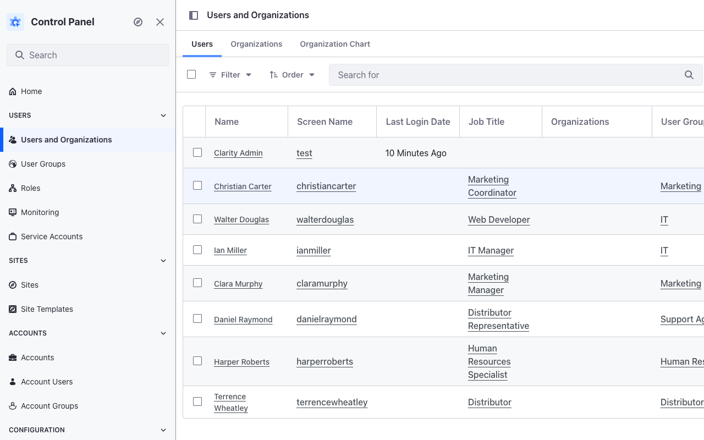

# Level 1 — Users and permissions

📖 Clarity's website is built by a team, not by one administrator. Before anyone can contribute, the instance needs their accounts, a way to group them (**user groups**), and **roles** that grant each person only what their work requires. A **regular** role applies everywhere in the instance; a **site** role applies only inside the sites where it's assigned. You'll give the roles their permissions once the site exists, in Level 2.

### 1.1 — Create Clarity's user groups, roles and personas

🎯 Five user groups, six custom roles and seven personas, each persona in its user group with its regular role and portrait.

🧩 `manage-roles-permissions`

📎 R1 — personas, user groups and roles.

💬 **Prompt:**
```
Using the manage-roles-permissions skill, set up Clarity's people from
context-source:

1. Create the user groups in data/user-groups.csv, with their descriptions.
2. Create the roles in data/roles.csv: "regular" rows as regular roles,
   "site" rows as site roles, each with its description.
3. Create the users in data/personas.csv, with an external reference code
   of the form PERSONA-<SCREENNAME>, the screen name, email, first and last
   name and job title from the file. Give each of them the password "learn"
   (the course's shared training password) and make sure none of them is
   asked to change it at first sign-in. Upload the portrait where the file
   lists one.
4. Add each user to the user group in their row, and assign them the
   regular role in the "regularRoles" column.

Make every step idempotent (upsert by external reference code or name), so
I can run this prompt again safely. Report a table of users with their
groups and roles as Liferay returns them, not as you intended them.
```

✅ **Verify** (as the Clarity Admin):
- Global Menu → *Control Panel* → *Users and Organizations*: the seven personas are listed and active. Open **Christian Carter**: his portrait shows, his job title is *Marketing Coordinator*, and under *Memberships* → *User Groups* he's in **Marketing**.
- *Control Panel* → *User Groups*: five groups. Open **Marketing**: Christian Carter and Clara Murphy are members.
- *Control Panel* → *Roles*: the *Regular Roles* tab has the five Clarity roles; the *Site Roles* tab has **Site Content Contributor**. Open **Marketing Coordinator** → *Assignees* → *Users*: **Christian Carter** is listed.
- In a private browser window, sign in as `christian.carter@clarityvisionsolutions.com` / `learn`. You land in the portal without a password change prompt.




📖 In the Control Panel you can also assign a role to a **user group**, so every member gets it. Liferay's headless API assigns roles to users only, so the agent assigns them one by one here. Look at both in *Control Panel* → *Roles* → a role → *Assignees*.

### ⭐ 1.2 — Bonus: a manager for the Marketing team

Let Clara Murphy view the members of the **Marketing** user group and add new ones, **without** the Administrator or Site Administrator role and without access to any other user group. Write the prompt yourself. Success: impersonating Clara, she can open *Control Panel* → *User Groups* → *Marketing* and add a member; another user group shows no *Assign Members* action.
