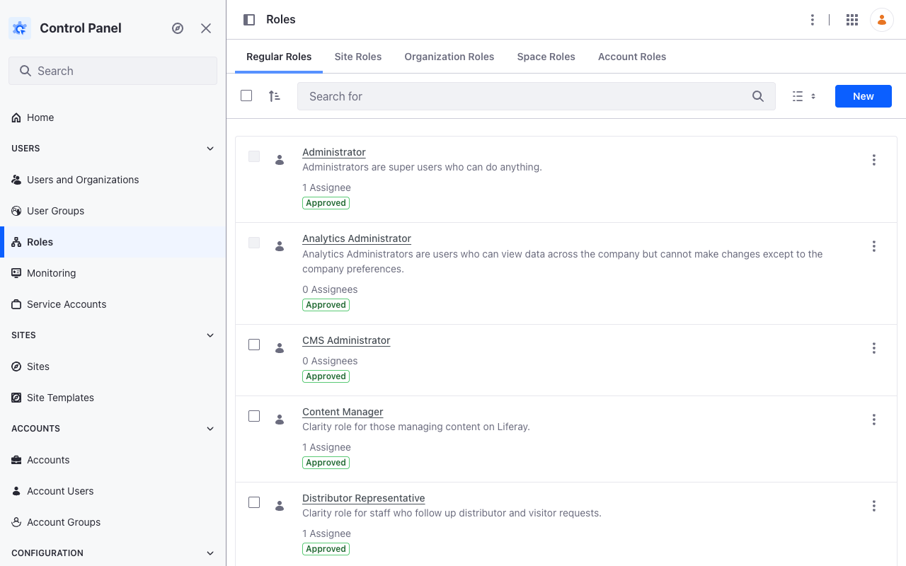

# Level 1 — Users and permissions

⏱ **About 45 minutes**, with the talk · **Builds on:** Setup

**What you'll build:** the accounts of the team that builds Clarity's website, grouped by department, each with a role that grants only what their work requires.

**Key terms**
- **Persona:** one of Clarity's seven test users, from `context-source/data/personas.csv`. Their password is `learn`.
- **User group:** a set of users, here one per Clarity department (for example *Marketing*).
- **Regular role:** a role that applies everywhere in the instance.
- **Site role:** a role that applies only inside the sites where it's assigned.
- **External reference code (ERC):** an ID you choose (here `PERSONA-<SCREENNAME>`) that lets a prompt find the same item again, so it can run twice safely.
- **Impersonate:** an admin action that opens Liferay as another user, so you see exactly what they see.

ℹ️ **Note:** the roles get their permissions once the site exists, in Level 2.

### 1.1 — Create Clarity's user groups, roles and personas

🎯 **Goal:** five user groups, six custom roles and seven personas, each persona in its user group with its regular role and portrait.

**Requirement:** R1 · **Skills:** `manage-roles-permissions`

💬 **Prompt:**
```
Using the manage-roles-permissions skill, set up Clarity's people from
context-source:

1. Create the user groups in data/user-groups.csv, with their descriptions.
2. Create the roles in data/roles.csv: "regular" rows as regular roles,
   "site" rows as site roles, each with its description.
3. Create the users in data/personas.csv, with an external reference code
   of the form PERSONA-<SCREENNAME>, the screen name, email, first and last
   name and job title from the file. Give each of them the password "learn"
   (the course's shared training password) and make sure none of them is
   asked to change it at first sign-in. Upload the portrait where the file
   lists one.
4. Add each user to the user group in their row, and assign them the
   regular role in the "regularRoles" column.

Make every step idempotent (upsert by external reference code or name), so
I can run this prompt again safely. Report a table of users with their
groups and roles as Liferay returns them, not as you intended them.
```

✅ **Verify** (look, don't change anything; as the Clarity Admin):
1. *Global Menu* → *Control Panel* → *Users and Organizations*: the seven personas are listed and active.
2. Open **Christian Carter**: the portrait shows, the job title is *Marketing Coordinator*, and *Memberships* → *User Groups* lists **Marketing**.
3. *Global Menu* → *Control Panel* → *User Groups*: five groups.
4. Open **Marketing**: Christian Carter and Clara Murphy are members.
5. *Global Menu* → *Control Panel* → *Roles*: the *Regular Roles* tab has the five Clarity roles, and the *Site Roles* tab has **Site Content Contributor**.
6. Open **Marketing Coordinator** → *Assignees* → *Users*: **Christian Carter** is listed.
7. In a private window, sign in as `christian.carter@clarityvisionsolutions.com` / `learn`: you land in the portal without a password change prompt.




📖 **Why it matters:** in the Control Panel you can also assign a role to a **user group**, so every member gets it. Liferay's headless API assigns roles to users only, so the agent assigns them one by one here. You can see both kinds of assignee in *Global Menu* → *Control Panel* → *Roles* → a role → *Assignees*.

## ⭐ Extras

Optional, for when you finish early. The next level doesn't depend on them.

### ⭐ 1.2 — Bonus: a manager for the Marketing team

🎯 **Goal:** Clara Murphy can view the members of the **Marketing** user group and add new ones, **without** the Administrator or Site Administrator role and without access to any other user group. Write the prompt yourself.

✅ **Success looks like:**
1. Impersonating Clara, you can open *Global Menu* → *Control Panel* → *User Groups* → *Marketing* and add a member.
2. Another user group shows no *Assign Members* action.
