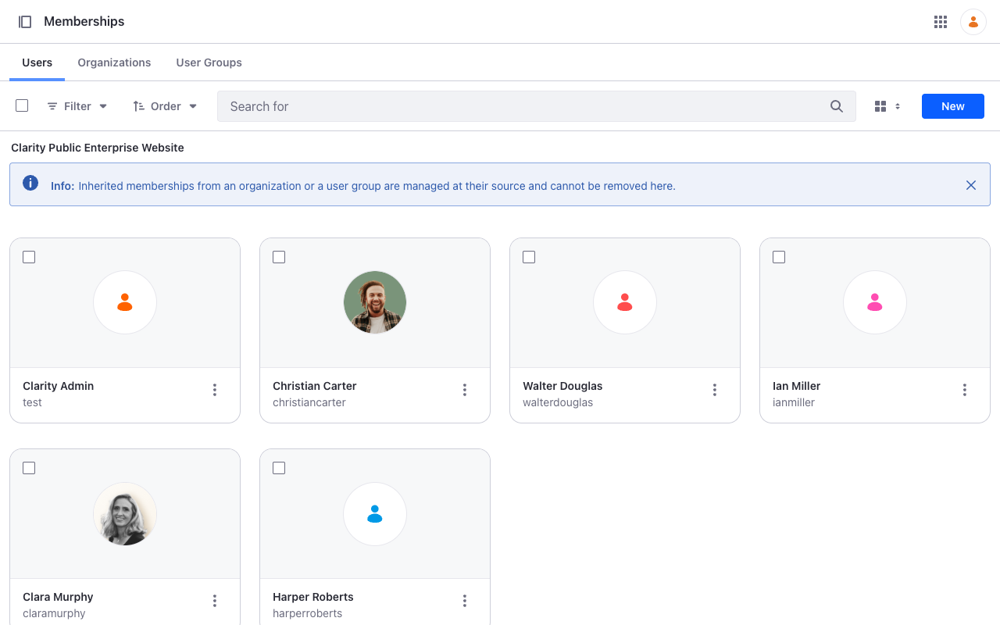

# Level 2 — Sites

⏱ **About 45 minutes**, with the talk · **Builds on:** Level 1

**What you'll build:** Clarity's public enterprise website, configured for launch, and an empty site for a future distributor portal. You also give the Marketing Coordinator role its permissions and point the instance at the public site.

**Key terms**
- **Site:** a set of pages with its own members and settings. Visitors who aren't signed in can see a public site's public pages.
- **Site Menu:** the panel on the left of a site, opened with the icon at the top left. It holds the site's *People*, *Site Builder*, *Design* and *Configuration* sections.
- **Site member:** a user who belongs to a site. Members get more than visitors through **site roles**.
- **Instance:** the whole Liferay installation. Some settings belong to a site (its address, languages, accessibility), others to the instance (such as where `http://localhost:8080/` takes you).
- **Virtual host:** a domain name, such as `www.clarityvisionsolutions.com`, that opens a site directly.
- **Permission:** an action (VIEW, ADD, UPDATE…) on a resource (an application, a kind of item), granted to a role.

### 2.1 — Create Clarity's two sites

🎯 **Goal:** **Clarity Public Enterprise Website** and **Clarity Distributor Portal**, both blank sites, with stable external reference codes so every later prompt can address them.

**Requirement:** R2 · **Skills:** `manage-sites`

💬 **Prompt:**
```
Create Clarity's two sites as blank sites (no template, no initializer),
as described in section 3 of context-source/clarity-brief.md:

- "Clarity Public Enterprise Website", external reference code
  clarity-public, friendly URL /clarity
- "Clarity Distributor Portal", external reference code
  clarity-distributor-portal, friendly URL /distributor-portal

If a site with that external reference code already exists, leave it as it
is and tell me. Read both back and show me their id, external reference
code, name and friendly URL. Add both to solution-index.yaml under R2.
```

✅ **Verify** (look, don't change anything):
1. *Global Menu* → *Control Panel* → *Sites*: both sites are listed.
2. Open **Clarity Public Enterprise Website**: it has no pages yet.


### 2.2 — Add members and assign site roles

🎯 **Goal:** the people who build and contribute to the public site are its members, with the right site roles.

**Requirement:** R1, R2 · **Skills:** `manage-sites`, `manage-roles-permissions`

💬 **Prompt:**
```
Using the manage-sites and manage-roles-permissions skills, set the members
of the site clarity-public:

- Walter Douglas has the site role Site Administrator.
- Christian Carter and Harper Roberts have the site role Site Content
  Contributor.
- Ian Miller and Clara Murphy are members with no extra site role.

Don't add any other member or role. Read the memberships and site roles
back from Liferay and show them as a table. Then tell me how I'd add a
whole user group as a site member, and whether you can do that through
the API on this release.
```

✅ **Verify** (look, don't change anything):
1. In the public site, *Site Menu* → *People* → *Memberships* → *Users* tab: Walter Douglas, Christian Carter, Harper Roberts, Ian Miller and Clara Murphy are listed (and you, the site's creator).
2. The Actions menu (⋮) next to Christian Carter → *Assign Site Roles*: **Site Content Contributor** is selected. Close it without saving.



📖 **Why it matters:** adding a **user group** as a site member makes every current and future member of the department a site member. Liferay's headless API can't do that on this release, so your agent told you the screen instead. You'll meet a few settings like this: part of working with an agent is knowing when the UI is the right tool.

### 2.3 — Configure the public site

🎯 **Goal:** the public site is ready for its audience: a description, open membership, English and Spanish only, Liferay's accessibility menu, and a virtual host.

**Requirement:** R2 · **Skills:** `manage-sites`

💬 **Prompt:**
```
Configure the site clarity-public as described in section 3 of
context-source/clarity-brief.md:

1. Description: the text in the brief.
2. Membership type: Open.
3. Languages: a custom set with only English (United States), the default,
   and Spanish (Spain).
4. Turn on the accessibility menu for this site only.
5. Virtual host for the public pages: www.clarityvisionsolutions.com.
   Keep the friendly URL /clarity.

Prefer the headless APIs; for a setting they don't cover, use the site's
group-scoped OSGi configuration; if neither exists, don't use an
unsupported API: give me the exact screen and field to set it myself.
Put settings 1–4 in a re-runnable script, scripts/site_settings.py: you'll
re-apply them after later deploys.
Tell me which mechanism you used for each setting, read each one back, and
check the accessibility menu is NOT on for the Clarity Distributor Portal.
```

📋 **After the prompt:**
1. Set the virtual host yourself on the screen the agent named (*Site Menu* → *Configuration* → *Site Settings* → *Site Configuration* → *Site URL* → *Public Pages* → *Virtual Host*), and save.

✅ **Verify** (look, don't change anything). All in the public site, under *Site Menu* → *Configuration* → *Site Settings*:
1. *Site Configuration* → *Details*: the description, and *Membership Type* **Open**.
2. *Site Configuration* → *Site URL*: friendly URL `/clarity`, and the virtual host `www.clarityvisionsolutions.com`.
3. *Localization*: only English (United States) and Spanish (Spain) are *In Use*.
4. *Accessibility*: the accessibility menu is enabled.

⚠️ **If it doesn't match:** `www.clarityvisionsolutions.com` doesn't open in your browser: that's expected. The virtual host only answers once that name resolves to your computer (a `hosts` file entry). You don't need it during the course: keep using `http://localhost:8080/web/clarity`.

### 2.4 — Give the Marketing Coordinator role its permissions

🎯 **Goal:** the **Marketing Coordinator** role can manage collections and categories in the sites its holders work in, and nothing more. You'll see the effect by impersonating Christian Carter before and after.

**Requirement:** R1 · **Skills:** `manage-roles-permissions`

📋 **Before the prompt:**
1. As the Clarity Admin, go to *Global Menu* → *Control Panel* → *Users and Organizations*, click the Actions menu (⋮) next to **Christian Carter**, and choose **Impersonate User**.
2. In the tab that opens, go to `http://localhost:8080/web/clarity` and open the *Site Menu*: Christian has no *Site Builder* or *Categorization* section. Keep the tab open.

💬 **Prompt:**
```
Using the manage-roles-permissions skill, grant the regular role "Marketing
Coordinator", at company scope, the permissions a marketing coordinator
needs to curate what the site shows, and nothing beyond that:

- Collections: access the Collections application in site
  administration, view it, add collections, and view and update
  collections;
- Categories: access the Categories application in site administration,
  view it, add vocabularies and categories, and view and update
  categories.

Before granting anything, read the role's current permissions and list the
resource names and action keys you'll add, and why each is needed. Don't
grant PERMISSIONS, DELETE or any administrator action, and don't touch any
other role. Afterwards, read the role's permissions back and show me the
difference.
```

✅ **Verify** (look, don't change anything):
1. *Global Menu* → *Control Panel* → *Roles* → **Marketing Coordinator** → *Define Permissions* → *Summary*: the permissions the agent listed, and nothing else.
2. Refresh the tab where you're impersonating Christian Carter: the *Site Menu* now has *Site Builder* → **Collections** and *Categorization* → **Categories**, with a **New** button in each. Don't save anything. Close the tab when you're done (*Be Yourself Again* in the user menu).

📖 **Why it matters:** a **regular** role's permissions apply at company scope: in every site its holder can work in. A **site** role's permissions apply only in the site where it's assigned, which is why Site Content Contributor exists. In Level 6, Liferay CMS Spaces add their own membership and roles on top: that's where Christian gets content-authoring rights.

### 2.5 — Point the instance at the public site

🎯 **Goal:** `http://localhost:8080/` opens Clarity's public site, and users land there after signing in or out.

**Skills:** `manage-sites`

💬 **Prompt:**
```
I want the instance's Home URL, Default Landing Page and Default Logout
Page to be /web/clarity. Check whether this release has a supported API or
OSGi configuration for these fields. If it has, set them and read them
back. If it hasn't, don't use an unsupported API and don't restart
Liferay: give me the exact screen and fields to set them myself.
```

📋 **After the prompt:**
1. If the agent gave you a screen, set the three fields there and save.

✅ **Verify** (look, don't change anything):
1. *Global Menu* → *Control Panel* → *Instance Settings* → *Platform* → *Instance Configuration* → *General*: the three fields read `/web/clarity`.
2. Open `http://localhost:8080/` in a private window: it redirects to the Clarity site (still empty until Level 3).

## 🧠 Knowledge check

⏱ **About 3 minutes, on your own.** Choose one answer for each question. Your instructor then goes over the answers with the class.

**Question 1.** In 2.4 you grant the **regular** role Marketing Coordinator permission to manage Collections, at company scope. Christian holds that role. In which sites can Christian now manage collections?

- **A.** Only in the public site, where Christian is a Site Content Contributor.
- **B.** In every site Christian can work in, because the role is regular.
- **C.** Only in sites where Christian also holds a site role.
- **D.** In none, until each site grants the permission in its own settings.

**Question 2.** The public site's membership type is **Open**. What does that allow?

- **A.** Visitors who aren't signed in can see the site's private pages.
- **B.** Every user group in the instance becomes a member of the site.
- **C.** Guest can add content, as long as a workflow reviews it.
- **D.** Any signed-in user can join the site without approval.

**Question 3.** 2.3 puts the site settings in a re-runnable script, `scripts/site_settings.py`. Why does the course need to run it again later?

- **A.** Each site deploy resets some of them, such as languages.
- **B.** Liferay forgets site settings each time the server restarts.
- **C.** The headless API can't store them, so a script holds them instead.
- **D.** Settings expire overnight and must be re-applied each morning.
