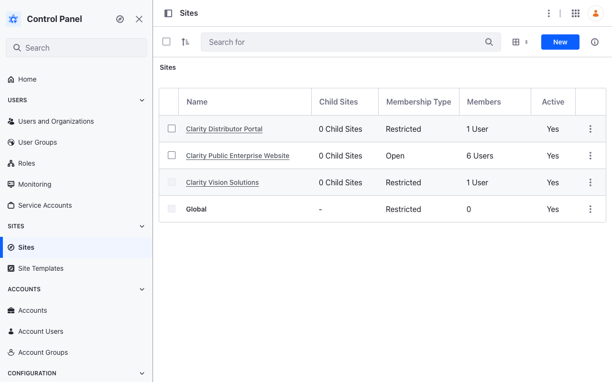

# Level 2 — Sites

📖 In Liferay DXP, each **site** has its own pages, members and settings. Clarity needs its public enterprise website, configured for launch, and an empty site for a future distributor portal. Visitors who aren't signed in can see a public site's public pages; members get more through **site roles**. Some settings belong to the site (its address, languages, accessibility), others to the whole **instance** (where `http://localhost:8080/` takes you).

### 2.1 — Create Clarity's two sites

🎯 **Clarity Public Enterprise Website** and **Clarity Distributor Portal**, both blank sites, with stable external reference codes so every later prompt can address them.

🧩 `manage-sites` 🆕

📎 R2 — the public site.

💬 **Prompt:**
```
Create Clarity's two sites as blank sites (no template, no initializer),
as described in section 3 of context-source/clarity-brief.md:

- "Clarity Public Enterprise Website", external reference code
  clarity-public, friendly URL /clarity
- "Clarity Distributor Portal", external reference code
  clarity-distributor-portal, friendly URL /distributor-portal

If a site with that external reference code already exists, leave it as it
is and tell me. Read both back and show me their id, external reference
code, name and friendly URL. Add both to solution-index.yaml under R2.
```

✅ **Verify:** Global Menu → *Control Panel* → *Sites*: both sites are listed. Open **Clarity Public Enterprise Website**: it has no pages yet.



### 2.2 — Add members and assign site roles

🎯 The people who build and contribute to the public site are its members, with the right site roles.

🧩 `manage-sites` 🆕, `manage-roles-permissions`

📎 R1, R2 — least privilege inside the site.

💬 **Prompt:**
```
Using the manage-sites and manage-roles-permissions skills, set the members
of the site clarity-public:

- Walter Douglas has the site role Site Administrator.
- Christian Carter and Harper Roberts have the site role Site Content
  Contributor.
- Ian Miller and Clara Murphy are members with no extra site role.

Don't add any other member or role. Read the memberships and site roles
back from Liferay and show them as a table. Then tell me how I'd add a
whole user group as a site member, and whether you can do that through
the API on this release.
```

✅ **Verify:** in the public site, open the Site Menu (the panel on the left; open it with the icon at the top left) → *People* → *Memberships*:
- the *Users* tab lists Walter Douglas, Christian Carter, Harper Roberts, Ian Miller and Clara Murphy (and you, the site's creator);
- the Actions menu (⋮) → *Assign Site Roles* for Christian Carter shows **Site Content Contributor** selected. Close it without saving.


📖 Adding a **user group** as a site member makes every current and future member of the department a site member. Liferay's headless API can't do that on this release, so your agent told you the screen instead. You'll meet a few settings like this: part of working with an agent is knowing when the UI is the right tool.

### 2.3 — Configure the public site

🎯 The public site is ready for its audience: a description, open membership, English and Spanish only, Liferay's accessibility menu, and a virtual host.

🧩 `manage-sites` 🆕

📎 R2 — address, languages and accessibility.

💬 **Prompt:**
```
Configure the site clarity-public as described in section 3 of
context-source/clarity-brief.md:

1. Description: the text in the brief.
2. Membership type: Open.
3. Languages: a custom set with only English (United States), the default,
   and Spanish (Spain).
4. Turn on the accessibility menu for this site only.
5. Virtual host for the public pages: www.clarityvisionsolutions.com.
   Keep the friendly URL /clarity.

Prefer the headless APIs; for a setting they don't cover, use the site's
group-scoped OSGi configuration; if neither exists, don't use an
unsupported API: give me the exact screen and field to set it myself.
Tell me which mechanism you used for each setting, read each one back, and
check the accessibility menu is NOT on for the Clarity Distributor Portal.
```

📋 **Steps:** set the virtual host yourself on the screen the agent named (*Site Settings* → *Site Configuration* → *Site URL* → *Public Pages* → *Virtual Host*), and save.

✅ **Verify:** in the public site, Site Menu → *Configuration* → *Site Settings*:
- *Site Configuration* → *Details*: the description, and *Membership Type* **Open**;
- *Site URL*: friendly URL `/clarity`, and the virtual host `www.clarityvisionsolutions.com`;
- *Localization*: only English (United States) and Spanish (Spain) are *In Use*;
- *Accessibility*: the accessibility menu is enabled.

⚠️ The virtual host only answers once `www.clarityvisionsolutions.com` resolves to your computer (a `hosts` file entry). You don't need it during the course: keep using `http://localhost:8080/web/clarity`.

### 2.4 — Give the Marketing Coordinator role its permissions

🎯 The **Marketing Coordinator** role can manage collections and categories in the sites its holders work in, and nothing more. You'll see the effect by impersonating Christian Carter before and after.

🧩 `manage-roles-permissions`

📎 R1 — least-privilege permissions.

📖 Permissions are actions (VIEW, ADD, UPDATE…) on resources (an application, a kind of item). A **regular** role's permissions apply at company scope: in every site its holder can work in. A **site** role's permissions apply only in the site where it's assigned, which is why Site Content Contributor exists. In Level 6, Liferay CMS Spaces add their own membership and roles on top: that's where Christian will get his content-authoring rights.

📋 **Steps:**
1. As the Clarity Admin, go to *Control Panel* → *Users and Organizations*, click the Actions menu (⋮) next to **Christian Carter**, and choose **Impersonate User**. In the tab that opens, go to `http://localhost:8080/web/clarity` and open the Site Menu: Christian has no *Site Builder* or *Categorization* section. Keep the tab open.
2. Send the prompt.

💬 **Prompt:**
```
Using the manage-roles-permissions skill, grant the regular role "Marketing
Coordinator", at company scope, the permissions a marketing coordinator
needs to curate what the site shows, and nothing beyond that:

- Collections: access the Collections application in site
  administration, view it, add collections, and view and update
  collections;
- Categories: access the Categories application in site administration,
  view it, add vocabularies and categories, and view and update
  categories.

Before granting anything, read the role's current permissions and list the
resource names and action keys you'll add, and why each is needed. Don't
grant PERMISSIONS, DELETE or any administrator action, and don't touch any
other role. Afterwards, read the role's permissions back and show me the
difference.
```

✅ **Verify:**
- *Control Panel* → *Roles* → **Marketing Coordinator** → *Define Permissions* → *Summary*: the permissions the agent listed, and nothing else.
- Refresh the tab where you're impersonating Christian Carter: the Site Menu now has *Site Builder* → **Collections** and *Categorization* → **Categories**, with a **New** button in each. Don't save anything. Close the tab when you're done (*Be Yourself Again* in the user menu).

📖 Liferay DXP 2026.Q1 moved Blogs, Documents and Media, Web Content and Asset Libraries to maintenance mode in favor of Liferay CMS, so this course doesn't build on them.

### 2.5 — Point the instance at the public site

🎯 `http://localhost:8080/` opens Clarity's public site, and users land there after signing in or out.

🧩 `manage-sites` 🆕

💬 **Prompt:**
```
I want the instance's Home URL, Default Landing Page and Default Logout
Page to be /web/clarity. Check whether this release has a supported API or
OSGi configuration for these fields. If it has, set them and read them
back. If it hasn't, don't use an unsupported API and don't restart
Liferay: give me the exact screen and fields to set them myself.
```

📋 **Steps:** if the agent gave you a screen, set the three fields there and save.

✅ **Verify:** Global Menu → *Control Panel* → *Instance Settings* → *Platform* → *Instance Configuration* → *General*: the three fields read `/web/clarity`. Open `http://localhost:8080/` in a private window: it redirects to the Clarity site (still empty until Level 3).
