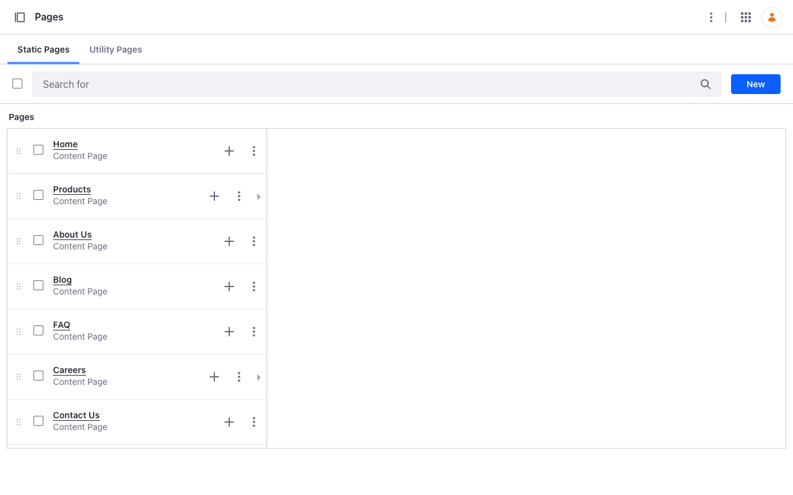
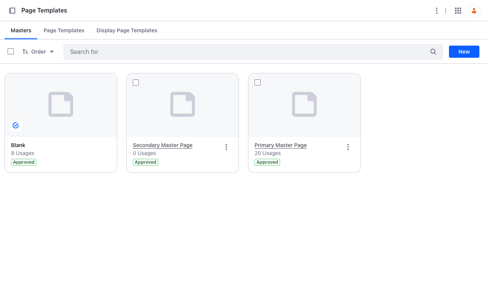
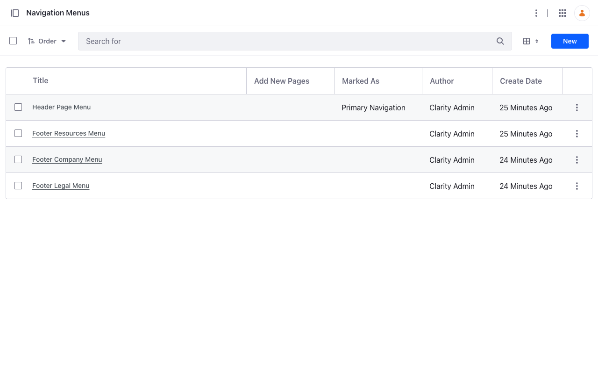

# Level 3 — Pages, master pages and navigation

📖 From here on, the site's structure lives in **code**: a *site initializer* client extension in `client-extensions/clarity-site/`. It's a folder tree of JSON files (pages, master pages, menus, fragments, style books) that Liferay applies to the site every time you deploy it. Your agent edits the tree and deploys it; you check the result in Liferay's own editors. Working this way, the site is version-controlled and can be rebuilt on any environment, and the agent never has to click through the page editor.

📖 A **content page** is built from fragments. A **master page** holds what every page shares (header, footer) around a *drop zone* where each page's own content goes. Clarity uses two: a **Primary Master Page** for content pages, and a lighter **Secondary Master Page** for the sign-in and utility pages. Each master page can limit which fragments authors may drop into pages that use it.

### 3.1 — Scaffold the site initializer and the page hierarchy

🎯 A `clarity-site` site initializer, bound to the existing site `clarity-public`, that creates Clarity's page hierarchy as empty content pages.

🧩 `scaffold-client-extension`, `manage-pages`, `deploy-and-verify`

📎 R3 — page hierarchy.

💬 **Prompt:**
```
Using the scaffold-client-extension, manage-pages and deploy-and-verify
skills, create a site initializer client extension in
client-extensions/clarity-site whose siteExternalReferenceCode is
clarity-public (the site created in Level 2: the initializer must update
that site, not create a new one).

In it, create the page hierarchy from section 4 of
context-source/clarity-brief.md as empty, public content pages, in this
order: Home (/home), Products (/products) with its child Product List
(/product-list), About Us (/about-us), Blog (/blog), FAQ (/faq), Careers
(/careers) with its child Open Positions (/open-positions), Contact Us
(/contact-us) and Search (/search-results — /search is reserved). Leave out
Product Detail, Events and Contact Us Responses: later levels add them.

Deploy it, confirm in the log that the initializer ran for clarity-public,
and read the page tree back from Liferay. Update solution-index.yaml (R3).
```

✅ **Verify:** in the public site, Site Menu → *Site Builder* → *Pages*: the pages are listed in this order, with **Product List** under **Products** and **Open Positions** under **Careers**. Open `http://localhost:8080/web/clarity/home`: an empty page with Liferay's default header.



### 3.2 — Build the Primary and Secondary master pages

🎯 Two master pages wireframed as in section 4 of the brief, applied to the pages, with the allowed fragments limited on the primary one.

🧩 `theme-and-design`, `manage-pages`

📎 R3 — master pages.

💬 **Prompt:**
```
Using the theme-and-design and manage-pages skills, add two master pages to
client-extensions/clarity-site, wireframed with Liferay's built-in Container,
Grid, Image, Paragraph and Menu Display fragments (no custom fragments yet;
Level 4 adds them):

Primary Master Page:
- A "Page Header" container holding:
  - a "Header Announcement Bar" container (empty for now; Level 7 fills it),
  - a "Header Navigation Bar" container, fixed width, with vertical padding
    spacer 3 and horizontal padding spacer 6, holding a three-column grid
    (middle column wider, vertically centered) whose columns contain:
    "Header Branding" (flex row, start: an Image fragment),
    "Header Navigation" (flex row, centered: a Menu Display fragment),
    "Header User Actions" (flex row, end: empty for now).
- The drop zone. On it, disallow the built-in "Footers" and "Navigation
  Bars" fragment sets.
- A "Page Footer" container with "Footer Branding" (an Image fragment),
  "Footer Navigation" (three Menu Display fragments side by side) and a
  "Footer Copyright" paragraph "© Clarity Vision Solutions".

Secondary Master Page: the same, without the Header Announcement Bar,
Footer Branding and Footer Navigation containers.

Name each container exactly as above (the names show in the page editor's
Browser panel). The Header Branding and Footer Branding Image fragments are
Clarity's logo (Level 7 maps it): keep them no wider than 200px.
Turn off the Classic theme's own header and footer on both masters. Apply
the Primary Master Page to every page from 3.1. Deploy, and confirm from
the log and from the pages' data that both masters exist and each page
uses the primary one.
```

✅ **Verify:**
- Site Menu → *Design* → *Page Templates* → *Masters*: **Primary Master Page** and **Secondary Master Page**. Open the primary one (click its name): the *Browser* panel (the tree icon on the left) shows *Page Header* → *Header Announcement Bar* and *Header Navigation Bar* → grid → *Header Branding*, *Header Navigation*, *Header User Actions*, then the drop zone and *Page Footer*. Select the drop zone and click *Configure Allowed Fragments*: **Footers** and **Navigation Bars** are unchecked. Leave the editor without publishing.
- Open the **Home** page: the header and footer wireframe surround an empty body.



### 3.3 — Create the navigation menus and wire them in

🎯 The four menus from section 4 of the brief, with the header and footer Menu Display fragments pointing at them.

🧩 `manage-pages`

📎 R3 — navigation.

💬 **Prompt:**
```
Using the manage-pages skill, add the four navigation menus from section 4
of context-source/clarity-brief.md to client-extensions/clarity-site, each
with its own external reference code. The Footer Legal Menu items are URL
items to https://www.clarityvisionsolutions.com/privacy and /terms, opening
in a new tab.

Then point the Menu Display fragments of both master pages at them: the
header one at Header Page Menu (on both masters), and the three footer ones
at Footer Resources Menu, Footer Company Menu and Footer Legal Menu, in that
order. Deploy, then count each menu's items over the API and compare with
the brief.
```

✅ **Verify:**
- Site Menu → *Site Builder* → *Navigation Menus*: four menus. Open **Header Page Menu**: Products, About Us, Blog, FAQ, Careers, Contact Us, in that order.
- Open the **Home** page: the header shows those six links, and the footer shows the three footer menus. Click **FAQ**: you're on the FAQ page.



### ⭐ 3.4 — Bonus: the Sign In utility page

Add a **Sign In** utility page that uses the **Secondary Master Page** and holds Liferay's Sign In widget, and make it the site's default sign-in page. Success: signing out and clicking *Sign In* shows Clarity's lighter header and footer around the sign-in form.
