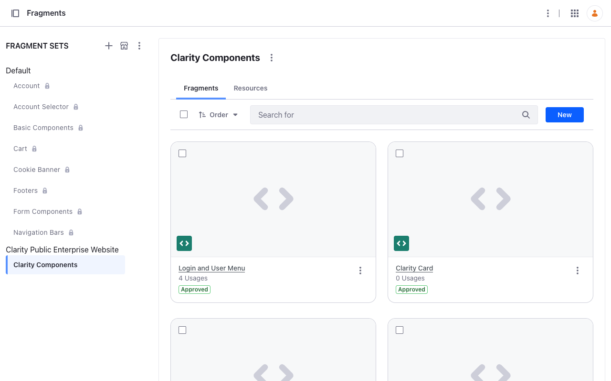

# Level 4 — Fragments and page compositions

📖 **Fragments** are the building blocks of content pages: HTML, CSS and JavaScript with editable areas, plus a JSON configuration that defines the options an author sets in the page editor (text, select, checkbox, color, URL…). Clarity keeps its own fragments in a **Clarity Components** fragment set. A **composition** is a saved arrangement of fragments that authors reuse; in the site initializer, a page's arrangement simply lives in its `page-definition.json`.

### 4.1 — Create the Clarity Components fragments

🎯 Five custom fragments in a *Clarity Components* set: **Search Button**, **Login and User Menu**, **Clarity Button**, **Clarity Card** and **FAQ Question and Answer Pair**.

🧩 `scaffold-fragment`

📎 R4 — reusable components.

💬 **Prompt:**
```
Using the scaffold-fragment skill, add a "Clarity Components" fragment set
to client-extensions/clarity-site with these fragments. Use
context-source/design-reference/clarity-components/ as the visual reference
(same markup ideas, editable ids and configuration), but write clean code
that works on this release, uses CSS variables rather than hard-coded
colors, and needs no theme other than Classic:

1. Search Button: a Clay icon link. Configuration: iconName (text, default
   "search"), iconSize (select: 1rem, 1.5rem, 2rem, 2.5rem, 3rem; default
   1rem), link (url), hideLabel (checkbox, default true) and buttonLabel
   (text, default "Search", shown only when hideLabel is false).
2. Login and User Menu: a "Sign In" button for guests, Liferay's user
   personal bar for signed-in users.
3. Clarity Button: an editable link styled as a button, with type (solid,
   outline, borderless), style (primary, secondary), size (small, regular,
   large) and inverted (checkbox) options.
4. Clarity Card: editable image "card-image", text "category", text
   "card-title", rich text "summary" and link "card-link" (editable ids
   exactly as written, so they can be mapped later).
5. FAQ Question and Answer Pair: an accessible disclosure with editable
   text "main-text" (the question) and rich text "answer-text".

Deploy, and check in the log that addFragmentEntries ran and none of the
fragments failed to compile.
```

✅ **Verify:** Site Menu → *Design* → *Fragments*: the **Clarity Components** set lists the five fragments. Click **Search Button**: the *Configuration* tab shows the five options, and the *Code* tab's preview shows a search icon. Close it without publishing.



### 4.2 — Put the custom fragments in the master pages

🎯 The search button and the login/user menu in the header of both master pages, the search button linking to the Search page.

🧩 `scaffold-fragment`, `manage-pages`

💬 **Prompt:**
```
In client-extensions/clarity-site, add the Search Button and Login and User
Menu fragments to the "Header User Actions" container of both master pages,
in that order. Configure the Search Button's link to the Search page
(/search-results). Deploy (fragments before pages: follow the deploy order
the site-initializer rules describe), and confirm on a rendered page as
Guest that both appear.
```

✅ **Verify:** open `http://localhost:8080/web/clarity/home` in a private window: the header shows a search icon and a **Sign In** button. Click the search icon: you land on the Search page. Sign in as any persona: the **Sign In** button is replaced by the user's avatar menu.

### 4.3 — Wireframe the Home and FAQ pages

🎯 The Home and FAQ pages laid out like Clarity's previous site, ready for content in Level 7.

🧩 `manage-pages`, `scaffold-fragment`

📎 R4 — page compositions.

💬 **Prompt:**
```
Using manage-pages, lay out two pages in client-extensions/clarity-site,
using the compositions in context-source/design-reference/compositions/
(page-composition-home.zip and page-composition-faq.zip) as the layout
reference. Unzip them to a temporary folder outside the workspace to read
them; don't import the zips.

Home: a "Banner" container holding a fixed-width "Banner Content"
container with a two-column grid (left: heading "Elevate Your Brand with
Premium Eyewear", a paragraph and a Clarity Button "Explore Products" to
/products; right: an Image fragment), a "Clarity Solutions Promo" container with a
"Content Wrapper" (heading, paragraph, Image), a "See the Difference"
section with three short value statements, a "Helpful Articles" container
(a heading only for now; Level 7 adds the collection) and a "Distributor
Promo" container (heading "Become a Clarity Distributor", a paragraph and a
Clarity Button to /contact-us).

FAQ: a two-column grid with an Image fragment on the left and an "FAQ
Content" container on the right holding four "FAQ Section" containers, one
per FAQ category in context-source/content/faqs.json, each with a heading
(the category name) and nothing else yet; then a "Promoted Articles"
container with a heading.

Use Clarity Button and built-in fragments only, name every container as
written, and deploy.
```

✅ **Verify:** open **Home** and **FAQ** in edit mode (the pencil icon at the top right). In the *Browser* panel, the containers carry the names from the prompt. Leave without publishing.

### ⭐ 4.4 — Bonus: a configurable sign-in URL

Change the **Login and User Menu** fragment so authors can set the sign-in button's target URL from the fragment configuration instead of a hard-coded one. Success: in the page editor, selecting the fragment shows a URL option, and changing it changes where *Sign In* goes.
