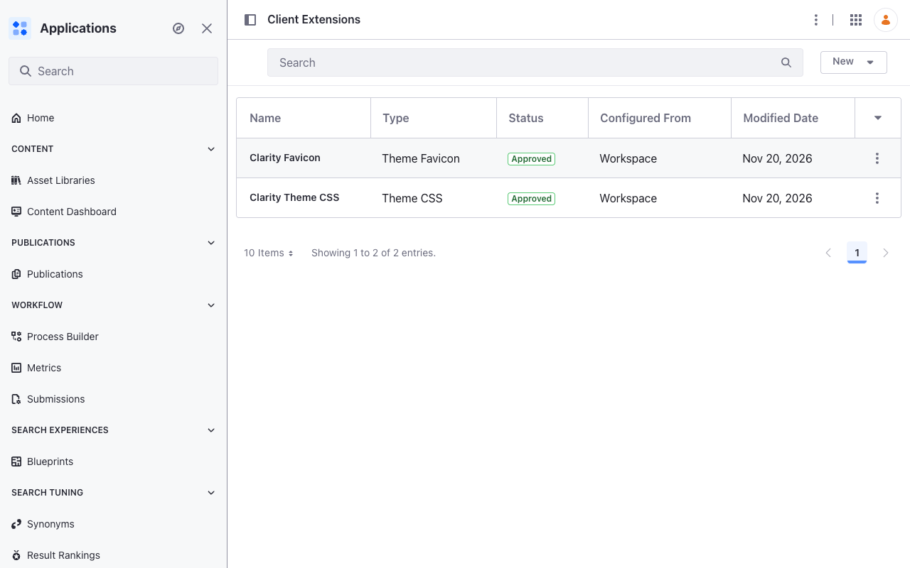

# Level 5 — Design: style book, Theme CSS, favicon and logo

⏱ **About 40 minutes**, with the talk · **Builds on:** Levels 3 and 4

**What you'll build:** Clarity's brand on every page: first a quick style book check, then Clarity's own Theme CSS and favicon client extensions, bound to the master pages, and the site logo.

**Key terms**
- **Design tokens:** a theme's named design values (colors, fonts, spacing), such as *Color Brand Primary*.
- **Style book:** a set of changes to a theme's design tokens, made without CSS. Each style book belongs to the theme it was made for.
- **Theme CSS client extension:** a client extension that replaces the theme's CSS entirely and declares its own tokens, which then appear in the page editor's style options.
- **Favicon:** the small icon in the browser tab. Clarity serves it from its own client extension.

ℹ️ **Note:** Liferay separates **what's on a page** from **how it looks**. Master pages carry the Theme CSS, so every page using them follows.

### 5.1 — A style book for a quick brand check

🎯 **Goal:** a **Clarity Style Book** for the Classic theme with Clarity's primary color, marked as the default.

**Requirement:** R5 · **Skills:** `theme-and-design`

💬 **Prompt:**
```
Using the theme-and-design skill, add a style book named "Clarity Style
Book" for the Classic theme to client-extensions/clarity-site, setting only
the Primary theme color to #187373, and make it the site's default style
book. Deploy and confirm the style book exists and is the default.
```

✅ **Verify** (look, don't change anything):
1. *Site Menu* → *Design* → *Style Books*: **Clarity Style Book** is marked *Default*.
2. Open it → *Color System* → *Theme Colors*: *Primary* is `#187373`, and the preview's buttons are teal. Leave the style book editor without publishing.
3. Open **Home**: the *Explore Products* button is teal.


### 5.2 — Clarity's Theme CSS and favicon client extensions

🎯 **Goal:** two frontend client extensions: **Clarity Theme CSS**, carrying Clarity's full brand from section 5 of the brief and declaring its color tokens for the page editor, and **Clarity Favicon**.

**Requirement:** R5 · **Skills:** `theme-and-design`, `scaffold-client-extension`, `deploy-and-verify`

💬 **Prompt:**
```
Using the theme-and-design and scaffold-client-extension skills, create a
frontend client extension project client-extensions/clarity-theme with:

1. A themeCSS client extension "Clarity Theme CSS", built on the Classic
   theme's CSS, applying the brand in section 5 of
   context-source/clarity-brief.md: the brand primary and secondary colors
   with their darker and lighter shades, the neutral colors, Poppins as the
   font, card and button radii. Include a frontend-token-definition.json
   that declares the brand colors (Color Brand Primary, its shades, Color
   Brand Secondary, Color Neutral 0 to 10) so they appear in the page
   editor's style options.
2. A themeFavicon client extension "Clarity Favicon" serving
   context-source/assets/branding/clarity-favicon.svg.

Keep these in their own project: a frontend project can't share one with
the site initializer. Deploy it and confirm both client extensions are
registered and the CSS URL answers 200.
```

✅ **Verify** (look, don't change anything):
1. *Global Menu* → *Applications* → *Client Extensions*: **Clarity Theme CSS** and **Clarity Favicon** are listed and *Ready*.



### 5.3 — Apply the brand to the site and its master pages

🎯 **Goal:** both master pages use Clarity Theme CSS; the site has Clarity's favicon and logo.

**Skills:** `theme-and-design`, `manage-pages`

💬 **Prompt:**
```
In client-extensions/clarity-site, bind Clarity Theme CSS (the themeCSS
client extension from client-extensions/clarity-theme) to both master pages,
and set the Clarity Favicon and the logo
context-source/assets/branding/clarity-logo-c.png on the site's public
pages. Use the site initializer where it supports a setting and the
headless APIs where it doesn't, and tell me which you used for each.
Redeploy (the Theme CSS must already be registered when the initializer
imports the masters), then fetch the Home page as Guest and show me the
stylesheet link of Clarity Theme CSS and the favicon link in its HTML.
```

✅ **Verify** (look, don't change anything):
1. Open **Home** in a private window: Poppins text, teal buttons, the Clarity favicon in the browser tab.
2. *Site Menu* → *Design* → *Page Templates* → *Masters* → **Primary Master Page** → the *Page Design Options* panel (the brush icon) → *More Page Design Options*: *Theme CSS Client Extension* shows **Clarity Theme CSS**. Leave without saving.
3. In the master's editor, select the *Header Announcement Bar* container → *Styles* → *Background*: the color picker offers **Color Brand Primary**. Leave without publishing.


📖 **Why it matters:** once a Theme CSS client extension replaces the theme's CSS, the Classic theme's style book no longer applies to those pages. 5.1 is a quick check; 5.2 is Clarity's real brand.

## 🧠 Knowledge check

⏱ **About 3 minutes, on your own.** Choose one answer for each question. Your instructor then goes over the answers with the class.

**Question 1.** After 5.3, someone changes the Primary color in **Clarity Style Book** to red. What changes on pages that use the Primary Master Page?

- **A.** The buttons turn red, because the style book is the site's default.
- **B.** Only the page editor's preview turns red, until the page is published.
- **C.** Only pages without a master page turn red.
- **D.** Nothing: Clarity Theme CSS has replaced what the style book styles.

**Question 2.** Why do Clarity Theme CSS and Clarity Favicon live in their own project, `client-extensions/clarity-theme`, and not in `clarity-site`?

- **A.** Frontend and site initializer extensions can't share a project.
- **B.** Themes must live in the workspace's themes/ folder instead.
- **C.** A separate project deploys faster and keeps the zip small.
- **D.** The favicon needs a project of its own, so the theme went with it.

**Question 3.** On a fresh environment, `clarity-site` is deployed before `clarity-theme`. Every page shows Classic's default look. What's the cause, and the fix?

- **A.** The style book overrides the Theme CSS. Delete the style book.
- **B.** Liferay caches CSS. Restart it to load the new stylesheet.
- **C.** The binding was skipped. Deploy the theme, then the site again.
- **D.** The Theme CSS belongs in metadata.json. Add it there and redeploy.
