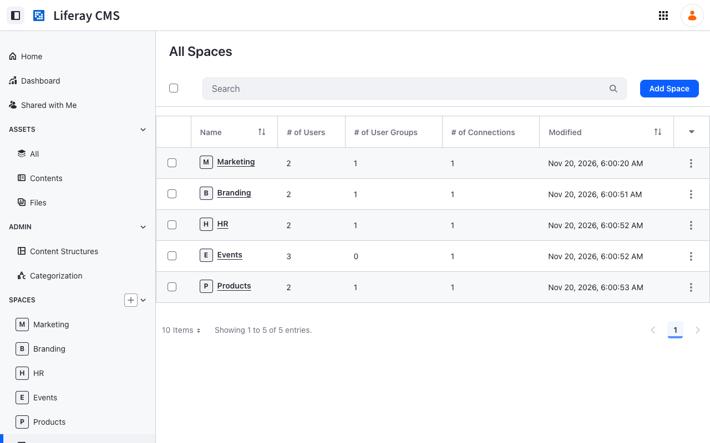
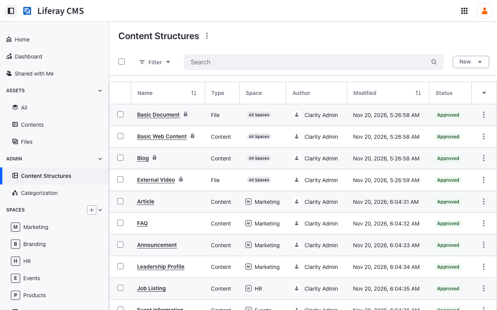
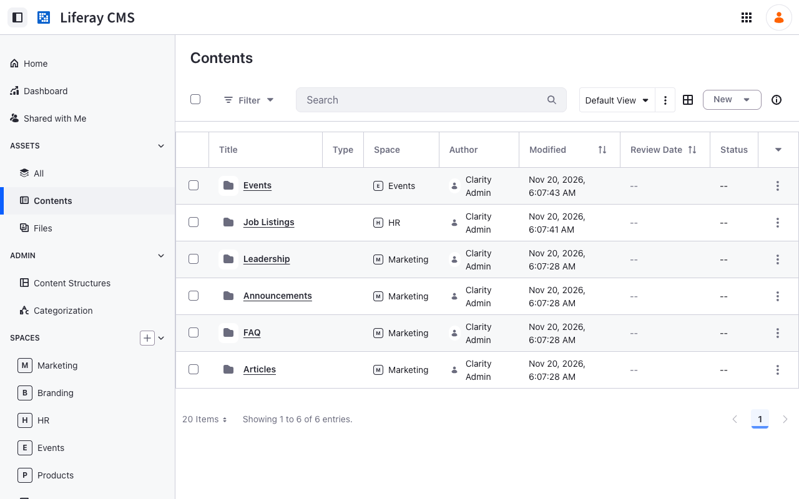

# Level 6 — Content in Liferay CMS

📖 **Liferay CMS** keeps content in **Spaces**, independent of the sites that display it. Each Space has its own members, folders, **content structures** (the fields of a kind of content, like *FAQ* or *Job Listing*), **file structures** (files with extra fields) and categories. A Space shows its content on a site once it's **connected** to that site. Publishing a structure also generates REST and GraphQL APIs for its content.

📖 Clarity used *Classic* web content and asset libraries on earlier releases. This course uses the new CMS throughout: Spaces replace asset libraries, content structures replace web content structures.

### 6.1 — Create the Spaces and their members

🎯 Five Spaces (Marketing, Branding, HR, Events, Products), each connected to the public site, with the right people as members.

🧩 `manage-cms`, `manage-roles-permissions`

📎 R6 — content shared across sites.

💬 **Prompt:**
```
Using the manage-cms and manage-roles-permissions skills, create the five
Spaces listed in section 6 of context-source/clarity-brief.md, each with an
external reference code of the form space-<name in lowercase> and a short
description. Connect each one to the site clarity-public (searchable).

Members:
- Marketing: the Marketing user group as members; Clara Murphy as the
  Space's administrator.
- Branding and Products: the IT user group as members; Walter Douglas as
  administrator.
- HR: the Human Resources user group as members; Harper Roberts as
  administrator.
- Events: Clara Murphy as administrator; Christian Carter as a member.

Use the Space roles Liferay provides on this release; list them first and
tell me which you chose for "administrator" and "member". Read each Space's
connected sites and members back, then tell me what a member of the site
clarity-public who isn't a member of a Space can do in it.
```

✅ **Verify:**
- Global Menu → **CMS**: the five Spaces are listed.


- Open the **Marketing** Space → its settings (the gear icon) → *Members*: the Marketing user group, and Clara Murphy with the administrator role. *Connected Sites*: Clarity Public Enterprise Website.
- Impersonate **Christian Carter** (as in 2.4) and open CMS. He sees every Space connected to the public site, because he's a member of that site. Open **HR**: he can browse it but has no **New** button. Open **Marketing**: he can add content there, as a member through the Marketing group. Close the tab when you're done.

📖 Connecting a Space to a site gives the site's members read access to it (the *Connected Site Member* Space role). Authoring takes Space membership and a Space role. Keep that in mind when a Space holds content site members shouldn't read: don't connect it to that site.

### 6.2 — Model Clarity's content structures

🎯 Seven structures: **Article**, **FAQ**, **Announcement**, **Leadership Profile**, **Job Listing**, **Event Information** (content) and **Event Image** (file), each limited to the Space that uses it.

🧩 `manage-cms`, `manage-objects`

📎 R6.

💬 **Prompt:**
```
Using the manage-cms skill, create these CMS structures, each accepted only
in the Space named, with an ERC of the form <NAME_IN_UPPER_SNAKE>_STRUCTURE,
a field ERC for every field, a field named "title" as the display title,
and categorization enabled. Model the fields on the matching file in
context-source/content/:

- Article (Marketing): title, headline (text), content (rich text),
  image (an attachment that links a file from the Space's Files).
- FAQ (Marketing): title (the question), answer (rich text).
- Announcement (Marketing): title, message (text, required), linkText
  (text, required), linkURL (text).
- Leadership Profile (Marketing): title (the person's name), jobTitle,
  bio (rich text), portrait (attachment linking a Space file).
- Job Listing (HR): title, roleOverview, keyResponsibilities,
  qualificationsAndSkills (all rich text).
- Event Information (Events): title, subtitleDescription (rich text),
  location (long text), startDateTime and endDateTime (date and time),
  ctaLink (text).
- Event Image (Events): a file structure with title (optional), the file
  (jpeg, jpg, png), and descriptionContext (long text).

Access expectations: members of a Space can add, view and update entries
of the structures that Space accepts, and add files to its Files folders;
only Space administrators can delete. Set this through the Space's roles,
not through regular roles.

Publish them, then read each one back and show its fields and its REST
path. Prove the access as Christian Carter (training password "learn") by
creating and deleting a throwaway FAQ in the Marketing Space: the create
must succeed and his delete must be refused.
```

✅ **Verify:** in CMS, open *Structures* (under the *Admin* section of the left panel): the seven structures are listed. Open **Event Information**: its fields and their types match the prompt, and *Spaces* lists only **Events**. Close it without saving.



### 6.3 — Create the vocabularies

🎯 The FAQ, Articles and job vocabularies with their categories, in the Spaces that use them.

🧩 `manage-cms`

📎 R6 — taxonomy.

💬 **Prompt:**
```
Using the manage-cms skill, create these vocabularies, each with an ERC,
upserted so the prompt can run again:

- In the Marketing Space: "FAQ" (categories: the four FAQ categories in
  context-source/content/faqs.json) and "Articles" (Innovation, Industry,
  Style), both limited to the structures that use them.
- In the HR Space: "Region", "Location" and "Job Positions", with the
  categories in context-source/data/job-taxonomy.csv.

Access expectations: the vocabularies and categories are shown to site
visitors (in facets and on cards), so Guest has VIEW on them, nothing more.

Read the vocabularies and category counts back.
```

✅ **Verify:** in CMS, open the **HR** Space → *Categories*: **Location** has 14 categories. Open the **Marketing** Space → *Categories* → **FAQ**: four categories.

### 6.4 — Load Clarity's content and files

🎯 Every Space holds Clarity's real content, categorized, in folders, with its images.

🧩 `manage-cms`

📎 R6.

💬 **Prompt:**
```
Using the manage-cms skill, load Clarity's content into the Spaces from
context-source (paths in context-source/README.md). Upload each image once
as a file in the Space that uses it, in a folder named after its kind, and
link it from the entries:

- Marketing: the articles (folder "Articles", categorized with the
  Articles vocabulary), the FAQs (folder "FAQ", each categorized with its
  FAQ category), the announcement (folder "Announcements"), the
  leadership profiles (folder "Leadership") and the marketing images
  (Files, folder "Marketing Images").
- HR: the job listings (folder "Job Listings"), each categorized with its
  region, location and job position.
- Events: the event image as an Event Image in a Files folder "Venues
  Gallery", and the event in a Contents folder "Events", both from
  context-source/content/events.json. Put the leadership portraits in a
  Marketing Files folder "Leadership".
- Branding: every file in context-source/assets/branding/ (Files).
- Products: every file in context-source/assets/products/ (Files).

Access expectations: these entries and files are for the public website,
so published entries and their linked files in Marketing, HR, Events,
Branding and Products must be viewable by Guest (VIEW, and DOWNLOAD_FILE
for files). Nothing else for Guest: no add, update or delete.

Write a small, re-runnable script in scripts/ (Python or Node) instead of
issuing hundreds of calls by hand, upserting by ERC. Run it, and show me a
count of entries and files per Space and folder. Then prove Guest access
by fetching one FAQ and one file with no credentials.
```

✅ **Verify:**
- In CMS, open **Marketing** → *Contents* → *FAQ*: eight FAQs. Open **What is your return policy?**: the answer is there and, in the side panel's *Categorization*, **Returns and Exchanges** is assigned. Close without saving.
- **HR** → *Contents* → *Job Listings*: ten listings.
- **Events** → *Files* → *Venues Gallery*: the event image shows a preview.


- Open one FAQ's permissions (its Actions menu → *Permissions*): **Guest** has *View* only.

### ⭐ 6.5 — Bonus: relate events to their images

Add a related-content field to **Event Information** that points at **Event Image** and allows several images, publish it again, and relate the showcase event to its image. Success: editing the event offers a picker that lists only Event Image files, and more than one can be chosen.
