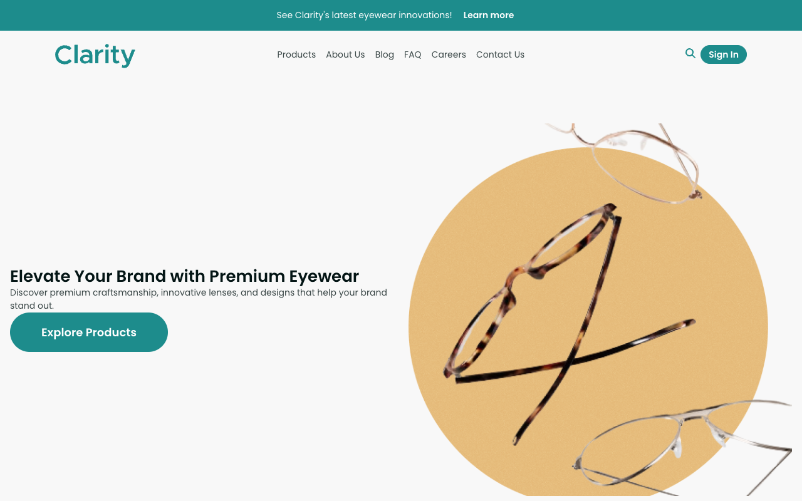
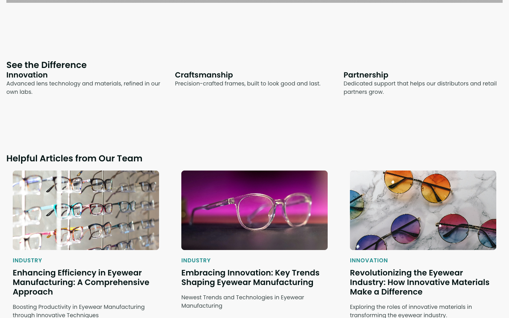
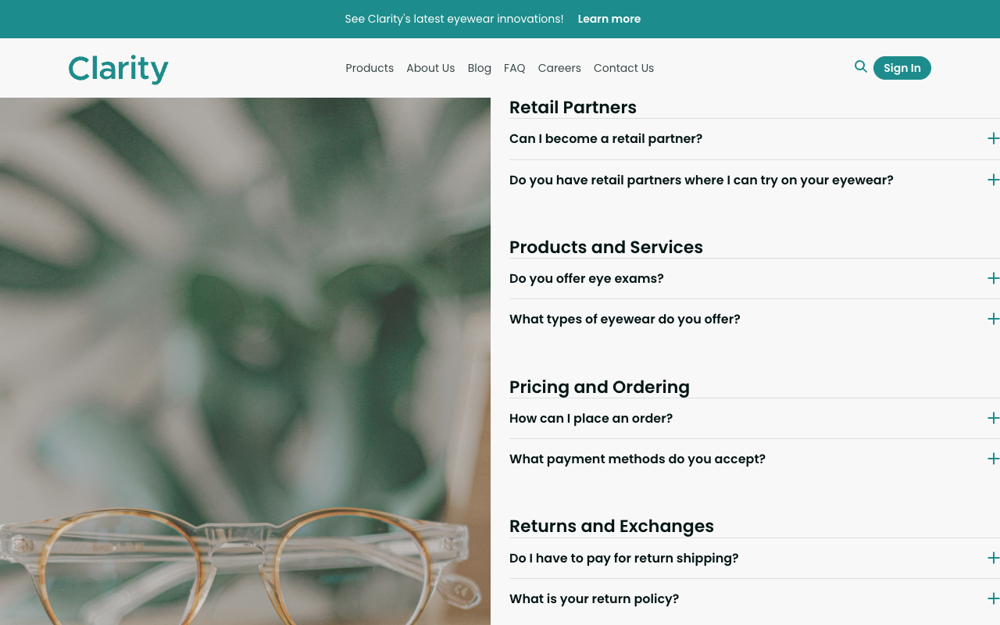

# Level 7 — Displaying content: mapping, display pages and collections

📖 A page shouldn't hold copies of content: it should **map** to it, so the page updates when the content changes. A fragment's editable image, text or link can be mapped to a field of a content item. A **display page template** gives every item of a structure its own page at its own URL, built once. A **collection** gathers items into a list: a *manual* collection holds the items you pick; a *dynamic* collection holds whatever matches its rules (a structure, a category…). A **Collection Display** fragment renders a collection on a page, one fragment per item.

### 7.1 — Map the Home page images to Marketing files

🎯 The Home page's images and the master pages' logos come from Space files, not from copies on the pages.

🧩 `manage-pages`, `manage-cms`

📎 R7.

💬 **Prompt:**
```
Using manage-pages and manage-cms, map the Home page's images in
client-extensions/clarity-site to files in the Marketing Space instead of
literal images:

- Banner image: home-banner-narrow-no-background
- Clarity Solutions Promo image: sunglasses-on-shelves
- Clarity Solutions Promo "Content Wrapper" background image:
  gradient-overlay
- Distributor Promo background image: home-promotion

Also make the Banner Content, Clarity Solutions Promo, See the Difference
and Helpful Articles containers fixed width.

In both master pages, map the "Header Branding" Image to the Branding
Space's logo-name-vector file and the "Footer Branding" Image (primary
master only) to logo-full-name-vector, each linking to the Home page and
no wider than 200px. Find each file in the Space by
its title, map by a reference that survives a rebuild (an ERC, not a
numeric id) if the format allows it, and tell me which form you used.
Deploy, then fetch Home as Guest and list the image URLs it renders.
```

✅ **Verify:** open **Home** in a private window: the banner shows the eyewear image, the promotion shows the shelves photo over the gradient, and the header and footer show Clarity's logo (click it: you're on Home). In edit mode, select the banner's *Image* fragment → its *image-square* element: *Source Selection* is **Mapping**, pointing at the Marketing file. Leave without publishing.



### 7.2 — Display page templates for articles and leadership profiles

🎯 Every Article and every Leadership Profile has its own page, rendered from one template each.

🧩 `manage-pages`

📎 R3, R7 — display pages.

💬 **Prompt:**
```
Using manage-pages, add two display page templates to
client-extensions/clarity-site, both marked default for their structure:

- "Article", for the Article CMS structure, on the Primary Master Page:
  title, headline, image and content, mapped to the entry's fields.
- "Leadership Profile", for the Leadership Profile structure, on the
  Secondary Master Page, laid out like
  context-source/design-reference/compositions/display-composition-leadership-profile.zip:
  portrait on the left; name, job title and bio on the right.

Deploy, then fetch one article's and one profile's display page URL as
Guest and confirm they render their own fields. Give me both URLs.
```

✅ **Verify:** open the two URLs in a private window: each shows its own content. Site Menu → *Design* → *Page Templates* → *Display Page Templates*: **Article** and **Leadership Profile** are marked *Default*.


⚠️ If a display page answers *404* for Guest, the Space's content may not be viewable by Guest, or the Space isn't connected to the site. Ask the agent to check both.

📖 Look at how the agent mapped images and attachments: by the file's numeric id. Those ids differ on every Liferay instance, so this part of the tree is tied to yours. Real projects handle it with a script that looks the ids up by name and rewrites them before each deploy to another environment. Ask your agent to write one if you finish early.

### 7.3 — Helpful Articles: a collection on Home

🎯 A **Helpful Articles** collection of Clarity's articles, displayed on Home as Clarity Cards that link to each article's display page.

🧩 `manage-pages`, `scaffold-fragment`

📎 R7.

💬 **Prompt:**
```
In client-extensions/clarity-site, create a dynamic collection "Helpful
Articles" of the Article entries in the Marketing Space, newest first, at
most 3 items. On Home, put a Collection Display of it in the "Helpful
Articles" container, one column on mobile, without pagination, rendering
each item with the Clarity Card fragment: card-image → image, category →
the entry's Articles category, card-title → title, summary → headline,
card-link → the entry's display page. Deploy and check as Guest that the
three cards render with their links.
```

✅ **Verify:** **Home** shows three article cards; clicking one opens its display page. Site Menu → *Site Builder* → *Collections*: open **Helpful Articles**: a dynamic collection, item type *Article*, scope the Marketing Space.



### ⭐ 7.3b — Bonus: a manual collection, by hand

A **manual** collection holds exactly the items you pick, in your order. The site initializer can't build one for CMS content on this release and no API writes collections, so this one is yours: in *Collections*, create a manual collection **Editor's Picks** with two Article entries, then ask your agent to show it on the Blog page as Clarity Cards. Success: the Blog page shows your two picks, in your order.

### 7.4 — The FAQ page from dynamic collections

🎯 Four dynamic collections (one per FAQ category) rendered on the FAQ page, plus the Helpful Articles under them.

🧩 `manage-pages`, `scaffold-fragment`

📎 R7.

💬 **Prompt:**
```
In client-extensions/clarity-site, create four dynamic collections named
"FAQ - <category>", one per FAQ category, each holding the FAQ entries of
the Marketing Space that have that category. On the FAQ page:

- set the left Image fragment to the Marketing file
  glasses-vertical-banner-with-text-lg;
- in each "FAQ Section", under its heading, a Collection Display of the
  matching collection, showing all items without pagination, each item
  rendered with the FAQ Question and Answer Pair fragment (main-text →
  title, answer-text → answer);
- in "Promoted Articles", the Helpful Articles collection as Clarity Cards,
  as on Home;
- "FAQ Content" and "Promoted Articles" fixed width.

Deploy and check as Guest that every question appears under its category.
```

✅ **Verify:** open **FAQ** in a private window: four sections, each with its questions; expanding **What is your return policy?** shows the answer under *Returns and Exchanges*. *Collections* lists four **FAQ - …** dynamic collections. Open **FAQ - Retail Partners**: its filter is the *Retail Partners* category.



### 7.5 — The announcement bar

🎯 The Primary Master Page's announcement bar shows the latest announcement, on Clarity's brand color, on every page.

🧩 `manage-pages`, `theme-and-design`

📎 R7.

💬 **Prompt:**
```
In client-extensions/clarity-site, create a dynamic collection
"Announcements" of the Announcement entries in the Marketing Space. In the
Primary Master Page's "Header Announcement Bar": a Collection Display of
it showing one item, without pagination, with an "Announcement" container
per item (flex row, centered, vertical padding spacer 2) holding a
Paragraph mapped to message and a Clarity Button (borderless, primary,
small, inverted) whose text maps to linkText and whose link maps to
linkURL. Give the bar the "Color Brand Primary" background and the
paragraph the "Color Neutral 0" text color from Clarity Theme CSS. Deploy
and check every page using the primary master shows it.
```

✅ **Verify:** every page (not Sign In) shows a teal bar above the header: *See Clarity's latest eyewear innovations!* and a **Learn more** link to Products.

⚠️ If the bar is empty after a deploy, redeploy once: the initializer sometimes imports the master page before the collection it points to exists.
