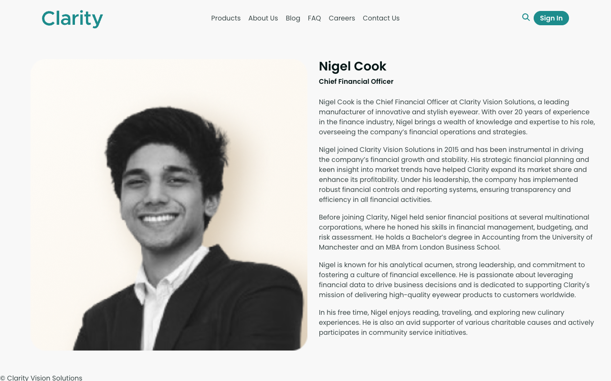

# Level 7 — Displaying content: mapping, display pages and collections

⏱ **About 90 minutes**, with the talk and the knowledge check · **Builds on:** Levels 3, 4 and 6

**What you'll build:** Clarity's pages show CMS content instead of copies of it. Home, FAQ and the announcement bar read from the Marketing Space, and every article and leadership profile gets its own page.

**Key terms**
- **Mapping:** a link from a fragment's editable image, text or link to a field of a content item, so the page updates when the content changes.
- **Display page template:** one template that gives every item of a structure its own page at its own URL.
- **Manual collection:** a list that holds exactly the items you pick, in your order.
- **Dynamic collection:** a list that holds whatever matches its rules (a structure, a category…).
- **Collection Display:** a fragment that renders a collection on a page, one fragment per item.

### 7.1 — Map the Home page images to Marketing files

🎯 **Goal:** the Home page's images and the master pages' logos come from Space files, not from copies on the pages.

**Requirement:** R7 · **Skills:** `manage-pages`, `manage-cms`

💬 **Prompt:**
```
Using manage-pages and manage-cms, map the Home page's images in
client-extensions/clarity-site to files in the Marketing Space instead of
literal images:

- Banner image: home-banner-narrow-no-background
- Clarity Solutions Promo image: sunglasses-on-shelves
- Clarity Solutions Promo "Content Wrapper" background image:
  gradient-overlay
- Distributor Promo background image: home-promotion

Also make the Banner Content, Clarity Solutions Promo, See the Difference
and Helpful Articles containers fixed width.

In both master pages, map the "Header Branding" Image to the Branding
Space's logo-name-vector file and the "Footer Branding" Image (primary
master only) to logo-full-name-vector, each linking to the Home page and
no wider than 200px. Find each file in the Space by
its title, map by a reference that survives a rebuild (an ERC, not a
numeric id) if the format allows it, and tell me which form you used.
Deploy, then fetch Home as Guest and list the image URLs it renders.
```

✅ **Verify** (look, don't change anything):
1. Open **Home** in a private window: the banner shows the eyewear image, and the promotion shows the shelves photo over the gradient.
2. In the same window, the header and footer show Clarity's logo. Click it: you're on Home.
3. As the admin, open **Home** in edit mode and select the banner's *Image* fragment → its *image-square* element: *Source Selection* is **Mapping**, pointing at the Marketing file. Leave without publishing.


🧪 **Acceptance criteria** (what the level's Playwright check tests, in ⭐ Extras):

- **AC 7.1-1** · *Browser, as Guest:* Home's banner, promotion, gradient and distributor images all load, and each comes from a file of the Marketing Space.
- **AC 7.1-2** · *Browser, as Guest:* the header logo is the Branding Space's `logo-name-vector` file, links to Home, and is no wider than 200px.

### 7.2 — Display page templates for articles and leadership profiles

🎯 **Goal:** every Article and every Leadership Profile has its own page, rendered from one template each.

**Requirement:** R3, R7 · **Skills:** `manage-pages`

💬 **Prompt:**
```
Using manage-pages, add two display page templates to
client-extensions/clarity-site, both marked default for their structure:

- "Article", for the Article CMS structure, on the Primary Master Page:
  title, headline, image and content, mapped to the entry's fields.
- "Leadership Profile", for the Leadership Profile structure, on the
  Secondary Master Page, laid out like
  context-source/design-reference/compositions/display-composition-leadership-profile.zip:
  portrait on the left; name, job title and bio on the right.

Deploy, then fetch one article's and one profile's display page URL as
Guest and confirm they render their own fields. Give me both URLs.
```

✅ **Verify** (look, don't change anything):
1. Open the two URLs the agent gave you in a private window: each shows its own content.
2. *Site Menu* → *Design* → *Page Templates* → *Display Page Templates*: **Article** and **Leadership Profile** are marked *Default*.



🧪 **Acceptance criteria** (what the level's Playwright check tests, in ⭐ Extras):

- **AC 7.2-1** · *API, as the admin:* the display page templates Article and Leadership Profile exist, each the default for its structure.
- **AC 7.2-2** · *Browser, as Guest:* an Article's display page shows its title and headline, and a Leadership Profile's shows the name, job title and bio.

⚠️ **If it doesn't match:** if a display page answers *404* for Guest, the Space's content may not be viewable by Guest, or the Space isn't connected to the site. Ask the agent to check both.

📖 **Why it matters:** the agent mapped images and attachments by the file's numeric id. Those ids differ on every Liferay instance, so this part of the tree is tied to yours. Real projects handle it with a script that looks the ids up by name and rewrites them before each deploy to another environment (see Extras).

### 7.3 — Helpful Articles: a collection on Home

🎯 **Goal:** a **Helpful Articles** collection of Clarity's articles, displayed on Home as Clarity Cards that link to each article's display page.

**Requirement:** R7 · **Skills:** `manage-pages`, `scaffold-fragment`

💬 **Prompt:**
```
In client-extensions/clarity-site, create a dynamic collection "Helpful
Articles" of the Article entries in the Marketing Space, newest first, at
most 3 items. On Home, put a Collection Display of it in the "Helpful
Articles" container, one column on mobile, without pagination, rendering
each item with the Clarity Card fragment: card-image → image, category →
the entry's Articles category, card-title → title, summary → headline,
card-link → the entry's display page. Deploy and check as Guest that the
three cards render with their links.
```

✅ **Verify** (look, don't change anything):
1. **Home** shows three article cards. Click one: its display page opens.
2. *Site Menu* → *Site Builder* → *Collections* → open **Helpful Articles**: a dynamic collection, item type *Article*, scope the Marketing Space.


🧪 **Acceptance criteria** (what the level's Playwright check tests, in ⭐ Extras):

- **AC 7.3-1** · *Browser, as Guest:* Home's Helpful Articles section shows three cards, the newest Article first, each with an image, category, title and summary.
- **AC 7.3-2** · *Browser, as Guest:* each card's link opens that Article's display page.

### 7.4 — The FAQ page from dynamic collections

🎯 **Goal:** four dynamic collections (one per FAQ category) rendered on the FAQ page, plus the Helpful Articles under them.

**Requirement:** R7 · **Skills:** `manage-pages`, `scaffold-fragment`

💬 **Prompt:**
```
In client-extensions/clarity-site, create four dynamic collections named
"FAQ - <category>", one per FAQ category, each holding the FAQ entries of
the Marketing Space that have that category. On the FAQ page:

- set the left Image fragment to the Marketing file
  glasses-vertical-banner-with-text-lg;
- in each "FAQ Section", under its heading, a Collection Display of the
  matching collection, showing all items without pagination, each item
  rendered with the FAQ Question and Answer Pair fragment (main-text →
  title, answer-text → answer);
- in "Promoted Articles", the Helpful Articles collection as Clarity Cards,
  as on Home;
- "FAQ Content" and "Promoted Articles" fixed width.

Deploy and check as Guest that every question appears under its category.
```

✅ **Verify** (look, don't change anything):
1. Open **FAQ** in a private window: four sections, each with its questions.
2. Under *Returns and Exchanges*, expand **What is your return policy?**: the answer shows.
3. *Site Menu* → *Site Builder* → *Collections*: four **FAQ - …** dynamic collections are listed.
4. Open **FAQ - Retail Partners**: its filter is the *Retail Partners* category.


🧪 **Acceptance criteria** (what the level's Playwright check tests, in ⭐ Extras):

- **AC 7.4-1** · *Browser, as Guest:* FAQ lists the FAQs under their four categories, eight in total.
- **AC 7.4-2** · *Browser, as Guest:* expanding *What is your return policy?* shows its answer.

### 7.5 — The announcement bar

🎯 **Goal:** the Primary Master Page's announcement bar shows the latest announcement, on Clarity's brand color, on every page.

**Requirement:** R7 · **Skills:** `manage-pages`, `theme-and-design`

💬 **Prompt:**
```
In client-extensions/clarity-site, create a dynamic collection
"Announcements" of the Announcement entries in the Marketing Space. In the
Primary Master Page's "Header Announcement Bar": a Collection Display of
it showing one item, without pagination, with an "Announcement" container
per item (flex row, centered, vertical padding spacer 2) holding a
Paragraph mapped to message and a Clarity Button (borderless, primary,
small, inverted) whose text maps to linkText and whose link maps to
linkURL. Give the bar the "Color Brand Primary" background and the
paragraph the "Color Neutral 0" text color from Clarity Theme CSS. Deploy
and check every page using the primary master shows it.
```

✅ **Verify** (look, don't change anything):
1. Open any page except Sign In: a teal bar above the header shows *See Clarity's latest eyewear innovations!* and a **Learn more** link to Products.

🧪 **Acceptance criteria** (what the level's Playwright check tests, in ⭐ Extras):

- **AC 7.5-1** · *Browser, as Guest:* Home and FAQ both show the announcement bar with the newest published Announcement's message and its link (after Level 10, *Spring into Style with Clarity…*).

⚠️ **If it doesn't match:** if the bar is empty after a deploy, redeploy once: the initializer sometimes imports the master page before the collection it points to exists.


## 🧠 Knowledge check

⏱ **About 3 minutes, on your own**, while your last prompt runs. Choose one answer for each question. Your instructor then goes over the answers with the class.

**Question 1.** Marketing replaces the `gradient-overlay` file in the Marketing Space with a new version. What happens to the Home page?

- **A.** Nothing, until someone edits and republishes the page.
- **B.** It shows the new image after the next site deploy.
- **C.** It shows the new image right away, with no page edit.
- **D.** The image breaks, since the mapping points to the old version.

**Question 2.** A new Article is published in the Marketing Space. What happens to **Helpful Articles** (dynamic, newest first, at most 3) and to a manual collection **Editor's Picks**?

- **A.** Both show it, each as its first item.
- **B.** Helpful Articles adds it; Editor's Picks stays.
- **C.** Neither changes until an editor updates them.
- **D.** Editor's Picks shows it; Helpful Articles doesn't.

**Question 3.** You deploy `clarity-site` to a fresh UAT environment. The display pages render, but the images mapped by file id show nothing. Why?

- **A.** UAT's Spaces aren't connected to the site yet.
- **B.** The file ids in the tree only exist locally.
- **C.** Images can't be mapped on display pages on UAT.
- **D.** UAT needs a restart before it serves new files.

## ⭐ Extras

Optional, for when you finish early. The next level doesn't depend on them.

### ⭐ 7.6 — Bonus: a manual collection, by hand

🎯 **Goal:** a manual collection **Editor's Picks** with two Article entries, shown on the Blog page as Clarity Cards. You build the collection by hand, then write your own prompt for the Blog page.

**Skills:** none for the collection, you do this yourself

📋 **Before the prompt:**
1. *Site Menu* → *Site Builder* → *Collections*: create a manual collection **Editor's Picks** with two Article entries.

💬 **Prompt:** write your own: ask your agent to show **Editor's Picks** on the Blog page as Clarity Cards.

✅ **Success looks like:**
1. The Blog page shows your two picks, in your order.

📖 **Why it matters:** a manual collection holds exactly the items you pick, in your order. The site initializer can't build one for CMS content on this release and no API writes collections, so this one is yours to make.

### ⭐ Bonus: look up file ids by name (after 7.2)

🎯 **Goal:** a script that looks up the ids of the files your display pages map, by name, and rewrites them before each deploy to another environment. You write the prompt yourself.

✅ **Success looks like:**
1. Your agent shows you the script and the ids it looked up by name.

📖 **Why it matters:** the agent mapped images and attachments by the file's numeric id, and those ids differ on every Liferay instance. A lookup by name keeps the tree portable.

### ⭐ 7.7 — Bonus: check Level 7 with Playwright

🎯 **Goal:** `tests/e2e/level-7.spec.ts`, with one test per acceptance criterion (🧪) of Level 7, added to the Playwright suite from 1.3. Write the prompt yourself: start from 1.3's and point it at this level's criteria.

📋 **Before the prompt:**
1. If you skipped 1.3, do it first: it sets up the suite and its sign-in helpers.

✅ **Success looks like:**
1. In `tests/e2e`, `npx playwright test level-7` runs one test per acceptance criterion of Level 7, each named by its id, and all pass.
2. In *Site Builder* → *Collections* → **Helpful Articles**, set the maximum number of items to 2, and run the tests again: **AC 7.3-1** fails. To undo it, redeploy the site with `scripts/deploy_site.sh`, and run them again: all pass.
3. `npx playwright test` still passes for every level you've added.
