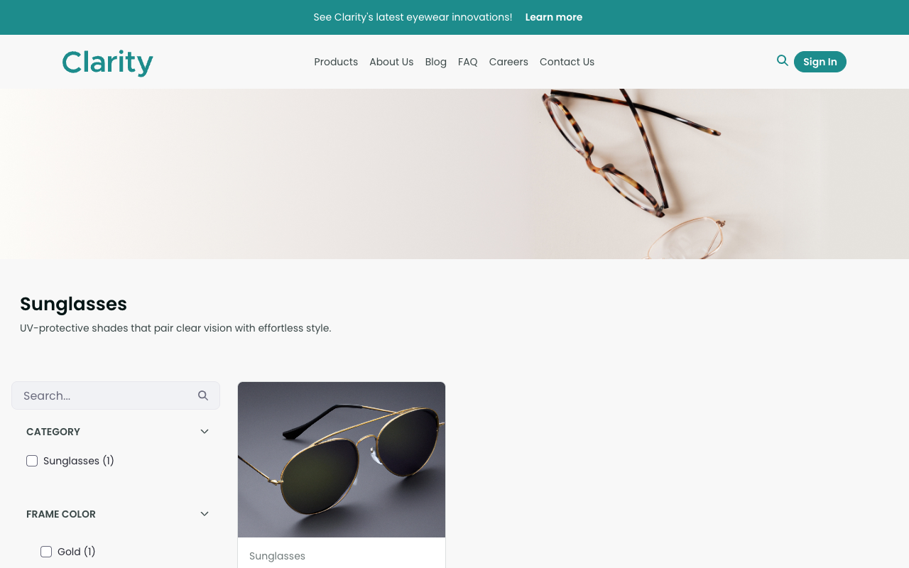
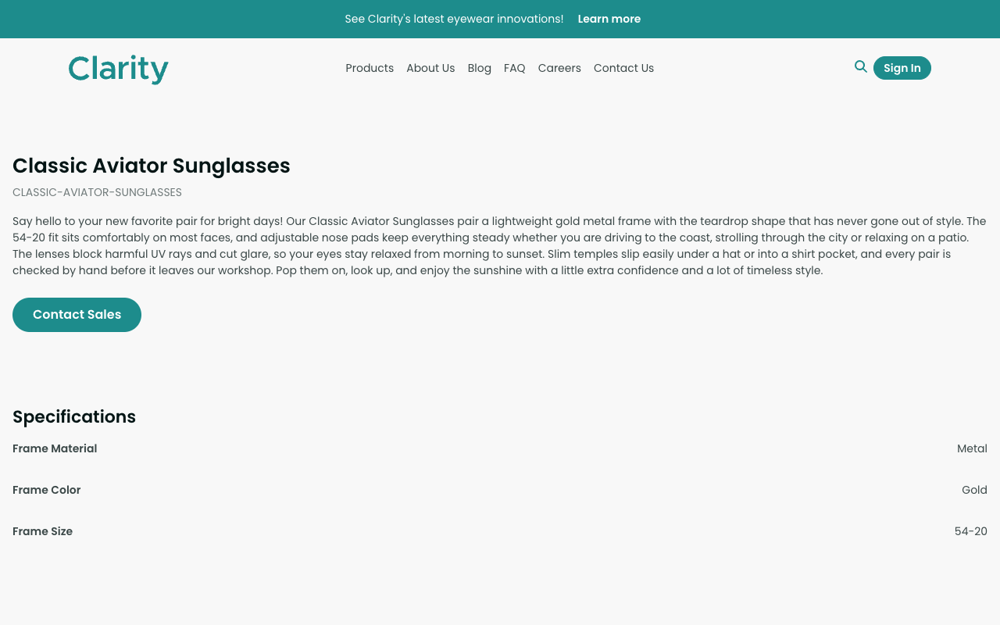

# Level 8 — Commerce: catalog, products and product pages

⏱ **About 50 minutes**, with the talk · **Builds on:** Levels 4 and 6

**What you'll build:** Clarity's products in a Commerce catalog, shown on the public site by category, each with its own product page. Clarity's site showcases products without taking orders: visitors browse by category and contact sales.

**Key terms**
- **Catalog:** the container Liferay Commerce organizes products in.
- **Specification:** a described product property (Frame Material, Frame Color…), grouped in a *specification group*.
- **Channel:** what Liferay Commerce sells products through. A site shows products once it's linked to a channel.
- **Facet:** a widget that lets visitors narrow a list of results by a value, such as a category or a specification.
- **Widget template:** a template you add that changes how a widget displays its items.

### 8.1 — The Clarity Eyewear catalog and its specifications

🎯 **Goal:** a **Clarity Eyewear** catalog, a **Frame Description** specification group, and three specifications (Frame Material, Frame Color, Frame Size).

**Requirement:** R8 · **Skills:** `commerce-catalogs`

💬 **Prompt:**
```
Using the commerce-catalogs skill, create the "Clarity Eyewear" catalog
(currency USD, language en_US, with an ERC), a specification group "Frame
Description" (key frame-description, priority 10), and three
specifications in it: Frame Material (key frame-material, used in faceted
navigation), Frame Color (key frame-color, used in faceted navigation) and
Frame Size (key frame-size), each with a short description. Upsert by key or
ERC. Read them back.
```

✅ **Verify** (look, don't change anything):
1. *Global Menu* → *Commerce* → *Catalogs*: **Clarity Eyewear** is listed.
2. *Global Menu* → *Commerce* → *Specifications* → *Specification Labels*: the three labels, with *Frame Description* as their default group.
3. On the same screen, Frame Material and Frame Color are marked *Use in Faceted Navigation*.

### 8.2 — Create the products

🎯 **Goal:** the three products in `context-source/data/products.csv`, categorized, with specifications, images and an AI-written description.

**Requirement:** R8 · **Skills:** `commerce-catalogs`

💬 **Prompt:**
```
Using the commerce-catalogs skill, create the products in
context-source/data/products.csv in the Clarity Eyewear catalog as simple
products, each with an ERC, its category from the "Clarity Products"
vocabulary (create that vocabulary with Eyeglasses, Sunglasses, Contacts
and Lenses at the instance's global scope if it doesn't exist), its tags,
the specification values in the file, its image (priority 10, titled like
the product), a short description from the file, and a full description of
about 120 words that you write in a friendly tone. Publish them. Read them
back with their categories, specifications and image count.
```

✅ **Verify** (look, don't change anything):
1. *Global Menu* → *Commerce* → *Products*: three products. None is in *Eyeglasses* yet: Level 9 imports some.
2. Open **Classic Aviator Sunglasses**: *Details* shows the description and the **Sunglasses** category.
3. *Specifications* lists Metal, Gold and 54-20.
4. *Media* shows the image.

📖 **Why it matters:** Liferay's AI Creator writes descriptions inside the product editor; here your agent wrote them. Your instructor shows both.

### 8.3 — A channel for the public site

🎯 **Goal:** a **Clarity Public** channel (site type B2B) linked to the public site.

**Skills:** `commerce-catalogs`

💬 **Prompt:**
```
Using the commerce-catalogs skill, create a channel "Clarity Public" (type
site, currency USD) linked to the site clarity-public, with the Commerce
site type B2B. Read it back, with the linked site.
```

✅ **Verify** (look, don't change anything):
1. *Global Menu* → *Commerce* → *Channels* → **Clarity Public**: the *Type* tab shows **Clarity Public Enterprise Website**.
2. The *General* tab shows *Commerce Site Type* **B2B**.

### 8.4 — Category cards on the Products page

🎯 **Goal:** the Products page shows the four product categories as cards, using a widget template.

**Requirement:** R8 · **Skills:** `manage-pages`

💬 **Prompt:**
```
In client-extensions/clarity-site, on the Products page, add a fixed-width
"Commerce Categories" container with the Commerce Categories Navigation
widget configured on the Clarity Products vocabulary (no root category),
displayed with a new widget template "Clarity Category Cards" (a
Commerce Categories Navigation template): a bento grid of cards in the
order Eyeglasses, Sunglasses, Contacts, Lenses, with widths 8/4/4/8, each
card with its category image (the Marketing files eyeglasses, sunglasses,
contacts and lenses), name, description and an "Explore" button to the
category's page. Look the images up by name with a script before deploying
rather than hard-coding ids, and make sure Guest can see the vocabulary
and its categories. Use the site initializer's ddm-templates for the
widget template. Deploy and check the page as Guest.
```

✅ **Verify** (look, don't change anything):
1. Open **Products** in a private window: four category cards in a bento layout.
2. *Site Menu* → *Design* → *Templates* → *Widget Templates*: **Clarity Category Cards** is listed.


### 8.5 — The Product List page and a product display page

🎯 **Goal:** clicking **Explore** lists the category's products as cards, and each product has a page built from a **Product Details** display page template.

**Requirement:** R8 · **Skills:** `manage-pages`

💬 **Prompt:**
```
In client-extensions/clarity-site:

1. On the Product List page: a Category Content widget under a banner,
   a Search Bar (searching everything), Search Options (empty searches
   allowed), a Category Facet and a Specification Facet in the left
   column, and a Commerce Search Results widget in the right column using a
   new widget template "Clarity Search Results Cards" (product image, name,
   category names and the frame-material specification as a badge).
   Make Product List the channel's default category display page.
2. A display page template "Product Details" for products, on the Primary
   Master Page, marked default: product name, SKU and description mapped to
   the product, a Clarity Button "Contact Sales" linking to /contact-us, a
   "Specifications" section listing each specification's name and value,
   and an "Attachments" section.

Deploy, then check as Guest: open a category from Products, then a product.
```

✅ **Verify** (look, don't change anything):
1. In a private window, open **Products** and click *Explore* on **Sunglasses**: the category page shows the facets (Category, Frame Color, Frame Material).
2. On the same page, **Classic Aviator Sunglasses** shows as a card.
3. Click it: its page shows the name, SKU, description, the three specifications and a **Contact Sales** button.





## 🧠 Knowledge check

⏱ **About 3 minutes, on your own.** Choose one answer for each question. Your instructor then goes over the answers with the class.

**Question 1.** You create a second site and add a Commerce Search Results widget to a page. It shows no products, though the catalog has eleven. What's most likely missing?

- **A.** The products aren't published on the new site.
- **B.** Guest can't see the Clarity Eyewear catalog.
- **C.** The widget has no widget template yet.
- **D.** The new site isn't linked to a channel.

**Question 2.** Visitors want to filter sunglasses by frame size, but the Specification Facet shows only Frame Color and Frame Material. Why?

- **A.** Frame Size isn't used in faceted navigation.
- **B.** The facet shows two specifications at most.
- **C.** Frame Size has no values on the products.
- **D.** Frame Size isn't in the Frame Description group.

**Question 3.** Marketing wants a **New** badge on the category cards on the Products page. Where does that change go?

- **A.** In a new field on each product.
- **B.** In the Clarity Products vocabulary's categories.
- **C.** In the Clarity Category Cards widget template.
- **D.** In Clarity Theme CSS, with a ::before rule.
