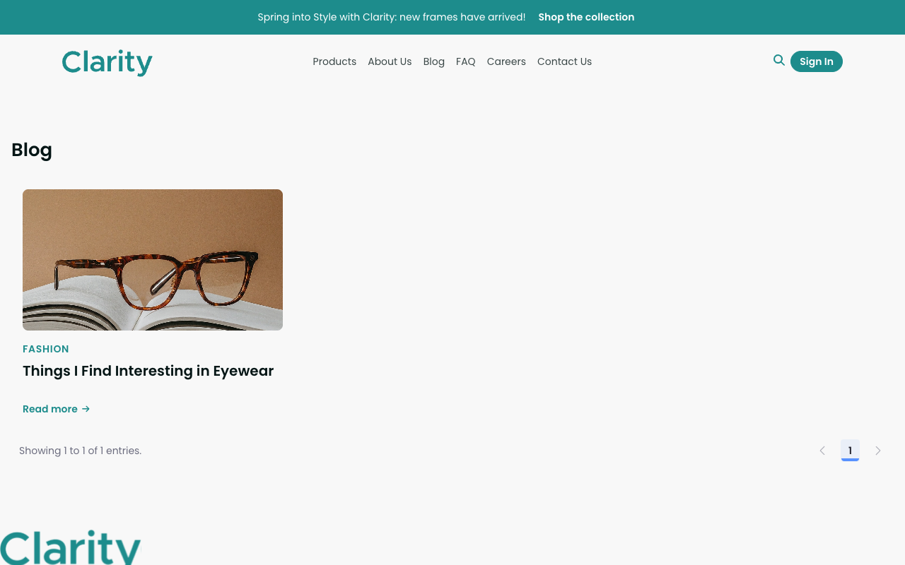

# Level 9 — Headless APIs: importing legacy data

📖 Everything you've done through your agent so far went through Liferay's **headless APIs**: REST (and GraphQL) endpoints for sites, pages, content, users, commerce and more. The **API Explorer** at `http://localhost:8080/o/api` documents and runs every one of them in your browser. **Batch** endpoints take a whole JSON array in one request and process it as an asynchronous task. Clarity has content and data in its old portal to bring across: that's what this level does, and you'll look at the same APIs your agent uses.

### 9.1 — Explore the API your agent uses

🎯 You can find, read and run an endpoint in the API Explorer yourself.

📋 **Steps:**
1. Open `http://localhost:8080/o/api` while signed in as the Clarity Admin.
2. Choose **headless-admin-user/v1.0** in the *REST Applications* menu, then find **GET /my-user-account**. Click *Execute*: the response is your own user, the same call your agent made in Setup.

💬 **Prompt:**
```
Using the liferay MCP server's discovery tools (or the OpenAPI spec at
/o/<module>/openapi.json if MCP isn't available), find the endpoints you'd
use to: (1) create an entry of Liferay CMS's built-in Blog structure, with
a cover image and a category, in the Marketing Space, (2) create Article entries in the Marketing Space in one
batch request, (3) create products in one batch request, (4) add
categories to a vocabulary in one batch request. For each, give me the
REST application, method and path, the request body's key fields, and how
I'd find the operation in the API Explorer. Don't call any of them yet.
```

✅ **Verify:** in the API Explorer, find each of the four operations the agent named, under the REST application it named, and read its request body schema. The fields match what the agent told you.

### 9.2 — Import the legacy blog post and articles

🎯 The legacy blog post as a **Blog** entry in the Marketing Space, shown on the Blog page, and three legacy articles in the Marketing Space, imported through the API.

🧩 `manage-cms`, `manage-pages`

📎 R9.

📖 Liferay CMS ships a built-in **Blog** structure (the replacement for the Blogs application, which is in maintenance mode on this release). Its entries live in a Space like your own structures.

💬 **Prompt:**
```
Import Clarity's legacy content from context-source/legacy-import/:

1. legacy-blog-post.json as an entry of the built-in CMS Blog structure
   in the Marketing Space, folder "Blog": upload its image as a file in
   the Space (Files folder "Blog Images") and use it as the cover image;
   categorize it with a "Blog Topics" vocabulary in the Marketing Space
   (Innovation, Industry, Style, Fashion; create it if it doesn't exist,
   limited to the Blog structure, Guest VIEW). The entry and its image are
   viewable by Guest.
2. legacy-articles.json as Article entries in the Marketing Space's
   "Articles" folder, in ONE batch request, categorized with the Articles
   vocabulary, linking the image file already in the Space.
3. In client-extensions/clarity-site: a dynamic collection "Blog Posts"
   (Blog entries of the Marketing Space, newest first), a Collection Display
   of it on the Blog page rendered with Clarity Cards (cover image,
   category, title, subtitle as the summary, link to the entry), and a display page template "Blog
   Post" for the Blog structure, on the Primary Master Page, marked
   default. Deploy.

For the batch, show me the request you send and poll the import task until
it completes; report its status and processed count. Then list what was
created, and fetch the Blog page and the post's display page as Guest.
```

✅ **Verify:**
- CMS → **Marketing** → *Contents* → *Blog*: **Things I Find Interesting in Eyewear**, with its cover image. *Articles*: six articles now.
- Open **Blog** in a private window: the post is a card; click it: its display page shows the title, image and text.


- `http://localhost:8080/o/api`: run **GET** on the batch task the agent reported (*headless-batch-engine* → `/import-task/{importTaskId}`): `executeStatus` is **COMPLETED**.

📖 A CMS structure has no batch endpoint of its own: the agent used the generic batch engine with the structure's delegate name (`C_Article`) and the Space as scope.

### 9.3 — Import legacy products and office locations

🎯 Eight legacy products in the catalog, and twelve new office locations in the HR Space's **Location** vocabulary, each through a batch request.

🧩 `commerce-catalogs`, `manage-cms`

📎 R9.

💬 **Prompt:**
```
From context-source/legacy-import/:

1. legacy-products.json: create the products in the Clarity Eyewear catalog
   in ONE batch request (headless-commerce-admin-catalog), with their ERCs,
   category (Clarity Products vocabulary), SKU and price, specifications,
   and the image of the matching category from the Marketing Space's files.
2. legacy-locations.json: add the locations to the HR Space's "Location"
   vocabulary in ONE batch request.

For each batch, show the request, poll the task until it completes and
report status and counts. Then assign the new location "Morocco,
Casablanca" to the job listing "Retail Associate" as an example.
```

✅ **Verify:** *Commerce* → *Products*: eleven products (your three plus eight legacy ones); the **Eyeglasses** category page now lists products. CMS → **HR** → *Categories* → **Location**: 26 categories. Open **Retail Associate**: *Morocco, Casablanca* is among its categories.
