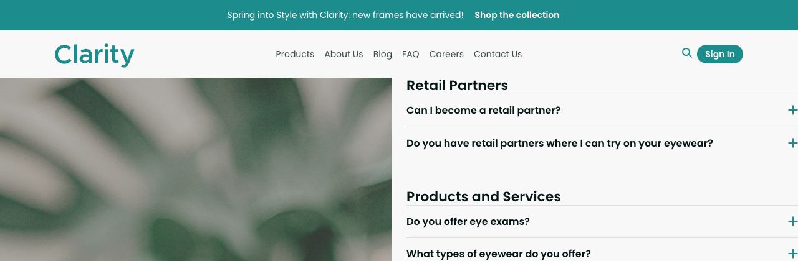

# Level 10 — Workflow and publishing

📖 **Workflow** puts a review step between *submitted* and *published*: an item waits, a reviewer is notified, approves or rejects it. Clarity's **Single Approver** workflow sends new content to a reviewer role, and nothing reaches visitors until it's approved.

### 10.1 — Approval workflow for Marketing articles

🎯 New and edited **Article** entries need a Content Manager's approval before they're published.

🧩 `manage-object-logic`, `manage-cms`

📎 R10.

💬 **Prompt:**
```
Using the manage-object-logic and manage-cms skills, make the Article CMS
structure go through the Single Approver workflow in the Marketing Space,
with the Content Manager role as the reviewer (Clara Murphy holds it).
Use the workflow definition Liferay ships; if its reviewer roles don't
include Content Manager, publish a copy named "Clarity Article Approval"
that does, instead of editing the original. Read back which workflow is
now linked to Article in the Marketing Space.
```

✅ **Verify:** CMS → **Marketing** → its settings → *Workflow*: **Article** uses the workflow the agent named. Global Menu → *Applications* → *Process Builder* → open it: the review task is assigned to **Content Manager**. Close without saving.

### 10.2 — Christian submits an article, Clara approves it

🎯 An article goes from Christian's draft to Clara's approval to the live site.

📖 Your agent can act **as** a persona by authenticating with that persona's credentials: Liferay then applies that user's permissions and records them as the author or reviewer. That's how you test a workflow end to end without switching browser sessions.

💬 **Prompt (part 1 — Christian submits):**
```
Authenticating as Christian Carter (christian.carter@clarityvisionsolutions.com,
training password "learn"), not as the admin, create an Article in the
Marketing Space's "Articles" folder: title "Clarity x Almanac Optics",
headline "Summer 2027 Collaboration", content "Eyewear enthusiasts rejoice!
Fan favorites Clarity and Almanac Optics have joined forces for a
collaborative collection.", image: the Space file revolutionizing_industry.
Submit it for workflow rather than saving it as a draft. Show me its status
as Liferay returns it, and its workflow instance.
```

✅ **Verify (part 1):** sign in as **Clara Murphy** in a private window. User menu (her avatar) → *My Workflow Tasks* → *Assigned to My Roles*: a review task for **Clarity x Almanac Optics**. Don't act on it. In CMS → **Marketing** → *Articles*, the entry is **Pending**, created by Christian Carter.

💬 **Prompt (part 2 — Clara approves):**
```
Authenticating as Clara Murphy (clara.murphy@clarityvisionsolutions.com,
training password "learn"), assign the pending review task of "Clarity x
Almanac Optics" to herself and approve it with the comment "Approved for
the summer campaign." Then list the workflow instance's tasks, who
completed each with which transition and comment, and the entry's status.
```

✅ **Verify (part 2):** as Clara, *My Workflow Tasks* → *Completed*: the task, approved, with the comment. In CMS the article is **Approved**, and it's published.

### 10.3 — Publish a site-wide change through workflow

🎯 The announcement bar on every page changes only after Clara approves the new announcement: Christian prepares it, nothing reaches visitors until approval, then it goes live everywhere at once.

🧩 `manage-object-logic`, `manage-cms`

📎 R10 — new content approved before it goes live.

📖 The announcement bar (Level 7.5) shows the newest Announcement entry of the Marketing Space. Putting the Announcement structure under the same approval workflow means a site-wide message can't go live without review. Liferay's **Publications**, which releases batches of page changes, is in maintenance mode on this release with no replacement, so the course uses workflow for publishing.

💬 **Prompt (part 1 — workflow on announcements):**
```
Link the "Clarity Article Approval" workflow from 10.1 to the Announcement
structure in the Marketing Space as well. Read back which workflow each of
Article and Announcement uses there.
```

💬 **Prompt (part 2 — Christian prepares the announcement):**
```
Authenticating as Christian Carter (training password "learn"), create an
Announcement in the Marketing Space's "Announcements" folder: title
"Spring Campaign", message "Spring into Style with Clarity: new frames
have arrived!", link text "Shop the collection", link URL /web/clarity/products.
Submit it for workflow. Show me its status, then fetch Home as Guest and
show me the announcement bar's text.
```

✅ **Verify (part 2):** open **Home** in a private window: the bar still says *See Clarity's latest eyewear innovations!*. As Clara, *My Workflow Tasks* → *Assigned to My Roles* lists **Spring Campaign**. Don't act on it.

💬 **Prompt (part 3 — Clara publishes it):**
```
Authenticating as Clara Murphy (training password "learn"), approve the
pending review task of the announcement "Spring Campaign" with the comment
"Go live." Then fetch Home and the FAQ page as Guest and show me the
announcement bar's text on each.
```

✅ **Verify (part 3):** open **Home** and **FAQ** in a private window: the bar reads *Spring into Style with Clarity: new frames have arrived!* with a **Shop the collection** link, on every page that uses the Primary Master Page.



⚠️ If the bar still shows the old text, the page may be cached for Guest: wait a minute and reload.

📖 CMS structures can also **schedule** an entry (a display date in the future): approve today, live on Monday. Ask your agent to schedule the next announcement if you finish early.
