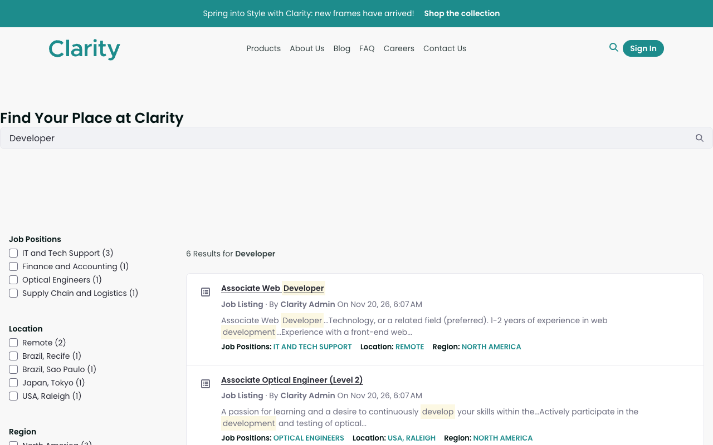

# Level 11 — Search: job openings, blueprints and events

📖 Liferay's **search widgets** (Search Bar, Search Results, facets, Search Options, Custom Filter) build pages where visitors find and filter content; all widgets on a page share one search. **Search Blueprints** change how results are filtered and scored without touching the page: a blueprint is a set of *query elements* (filters, boosts…) that a page applies through the *Blueprints Options* widget. A blueprint can also be a **collection provider**, so a Collection Display renders its results.

### 11.1 — The Open Positions job search

🎯 Open Positions is a working job search: a search bar, a category facet grouped by vocabulary, results, and empty searches allowed. The Careers page links to it.

🧩 `manage-pages`

📎 R11.

💬 **Prompt:**
```
In client-extensions/clarity-site, build the Open Positions page as a job
search, laid out like this: a "Banner" container with a heading and a
Search Bar widget (minimum width 500px); then a fixed-width "Search Results
and Options" container holding a two-column grid: left, a Category Facet
showing all vocabularies, grouped by vocabulary (write a facet widget
template "Clarity Search Category" if the default display can't group);
right, Search Results. Under the grid, a Search Options widget with "Allow
Empty Searches" on. Also give the Careers page a banner with a Clarity
Button "Explore Open Positions" linking to Open Positions.

The CMS job listings must be searchable from the public site (the HR Space
is connected to it). Deploy, then search as Guest for "Developer" and list
what the results show.
```

✅ **Verify:** open **Careers** in a private window, click **Explore Open Positions**. Search for *Developer*: both web developer listings appear. Click *Remote* in the *Location* group of the facet: the results narrow.



### 11.2 — A blueprint that keeps only job listings and boosts associates

🎯 A **Boost Associate Job Listings** blueprint: only Job Listing entries, with *Associate* positions first, applied to Open Positions.

🧩 `manage-pages`

📎 R11.

💬 **Prompt:**
```
Create a Search Blueprint "Boost Associate Job Listings" (with an ERC) that
1) filters to Job Listing CMS entries only, using the field that identifies
an object entry's definition (read the indexed fields of one job listing
first to find it), and 2) boosts results whose title matches all the
keywords of "Associate". Use the search-experiences REST API; validate the
blueprint with its preview/search endpoint before saving. Then add a
Blueprints Options widget with this blueprint to the Open Positions page in
client-extensions/clarity-site, under Search Options, and deploy. Search
"Engineer" as Guest and show the order of results before and after.
```

✅ **Verify:** Global Menu → *Applications* → *Blueprints*: open **Boost Associate Job Listings** → *Preview*, search *Associate*: Associate listings come first, and no FAQ or article appears. Close without saving. On **Open Positions**, an empty search lists only job listings, Associate ones first.

### 11.3 — The Events page of upcoming hiring events

🎯 An **Events** page whose *Upcoming Events* list comes from a **Future Events** blueprint used as a collection provider: only events that haven't started, soonest first.

🧩 `manage-search` 🆕, `manage-cms`, `manage-pages`

📎 R11.

💬 **Prompt:**
```
1. Create the hiring events in context-source/content/hiring-events.json
   as Event Information entries in the Events Space, in a Contents folder
   "Hiring Events", dated relative to today as the file says, viewable by
   Guest.
2. Create a search element "Future Events" that keeps only Event
   Information entries whose start date and time is after now, and a
   blueprint "Future Events", enabled as a collection provider for Event
   Information, with that element, sorted by start date ascending. Read
   one event's indexed fields first to find the date field's name and
   type.
3. In client-extensions/clarity-site, add an Events page (/events) on the
   Primary Master Page with an "Upcoming Events" container: a heading
   "Upcoming Events" and a Collection Display of that collection
   provider, flex column, no pagination (don't set "display all items"),
   each item a Heading (H4, title)
   and a Paragraph (location). Add Events to the Footer Resources Menu
   after Careers. Deploy and check as Guest.
```

✅ **Verify:** open **Events** in a private window: *Upcoming Events* lists **Summer Job Fair**, **Campus Recruiting Event** and **Clarity Vision Showcase 2027**, soonest first, and not the past *Spring Job Fair*. *Applications* → *Blueprints* → **Future Events** → *Preview*: the same three, in that order.


📖 The original BEWL course used the Calendar widget here. On this release calendar events have no REST API, so the course keeps events in Liferay CMS, where your agent can create them and a blueprint can query them.

### ⭐ 11.4 — Bonus: find a user by an external id through search

Clarity's benefits system knows employees by a registration id. Extend the **User** system object with an Object field **registrationId** (Integer), set it to `555777` on Ian Miller, create a **Registration ID** blueprint that filters users on that field with the search keywords, and have your agent call `POST /o/search/v1.0/search` with the blueprint and the keyword `555777`. Success: the response returns Ian Miller, and only him. (Use an Object field, not a Custom Field: Liferay recommends Objects for extending system entities.)
