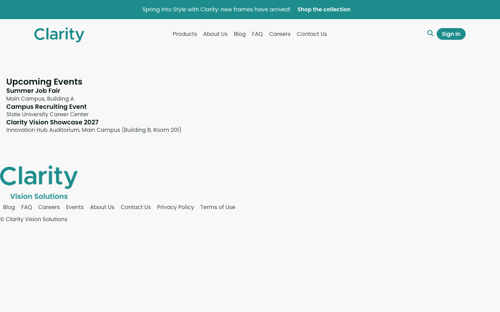

# Level 11 — Search: job openings, blueprints and events

⏱ **About 55 minutes**, with the talk · **Builds on:** Levels 6 and 7

**What you'll build:** an Open Positions job search for Clarity's CMS job listings, tuned by a blueprint, and an Events page that lists only upcoming hiring events.

**Key terms**
- **Search widgets:** Search Bar, Search Results, facets, Search Options and Custom Filter. They build pages where visitors find and filter content, and all widgets on a page share one search.
- **Search Blueprint:** a set of *query elements* (filters, boosts…) that changes how results are filtered and scored without touching the page.
- **Search element:** a query element you create yourself and use in a blueprint.
- **Blueprints Options:** the widget that applies a blueprint to the search on a page.
- **Collection provider:** a source of items that a Collection Display can render like a collection. A blueprint can be one, so a Collection Display renders its results.

### 11.1 — The Open Positions job search

🎯 **Goal:** Open Positions is a working job search: a search bar, a category facet grouped by vocabulary, results, and empty searches allowed. The Careers page links to it.

**Requirement:** R11 · **Skills:** `manage-pages`

💬 **Prompt:**
```
In client-extensions/clarity-site, build the Open Positions page as a job
search, laid out like this: a "Banner" container with a heading and a
Search Bar widget (minimum width 500px); then a fixed-width "Search Results
and Options" container holding a two-column grid: left, a Category Facet
showing all vocabularies, grouped by vocabulary (write a facet widget
template "Clarity Search Category" if the default display can't group);
right, Search Results. Under the grid, a Search Options widget with "Allow
Empty Searches" on. Also give the Careers page a banner with a Clarity
Button "Explore Open Positions" linking to Open Positions.

The CMS job listings must be searchable from the public site (the HR Space
is connected to it). Deploy, then search as Guest for "Developer" and list
what the results show.
```

✅ **Verify** (look, don't change anything):
1. Open **Careers** in a private window and click **Explore Open Positions**: Open Positions opens.
2. Search for *Developer*: both web developer listings appear.
3. Click *Remote* in the *Location* group of the facet: the results narrow.


### 11.2 — A blueprint that keeps only job listings and boosts associates

🎯 **Goal:** a **Boost Associate Job Listings** blueprint: only Job Listing entries, with *Associate* positions first, applied to Open Positions.

**Requirement:** R11 · **Skills:** `manage-pages`

💬 **Prompt:**
```
Create a Search Blueprint "Boost Associate Job Listings" (with an ERC) that
1) filters to Job Listing CMS entries only, using the field that identifies
an object entry's definition (read the indexed fields of one job listing
first to find it), and 2) boosts results whose title matches all the
keywords of "Associate". Use the search-experiences REST API; validate the
blueprint with its preview/search endpoint before saving. Then add a
Blueprints Options widget with this blueprint to the Open Positions page in
client-extensions/clarity-site, under Search Options, and deploy. Search
"Engineer" as Guest and show the order of results before and after.
```

✅ **Verify** (look, don't change anything):
1. *Global Menu* → *Applications* → *Blueprints* → open **Boost Associate Job Listings** → *Preview*, and search *Associate*: Associate listings come first, and no FAQ or article appears. Close without saving.
2. On **Open Positions**, run an empty search: it lists only job listings, Associate ones first.

### 11.3 — The Events page of upcoming hiring events

🎯 **Goal:** an **Events** page whose *Upcoming Events* list comes from a **Future Events** blueprint used as a collection provider: only events that haven't started, soonest first.

**Requirement:** R11 · **Skills:** `manage-search`, `manage-cms`, `manage-pages`

💬 **Prompt:**
```
1. Create the hiring events in context-source/content/hiring-events.json
   as Event Information entries in the Events Space, in a Contents folder
   "Hiring Events", dated relative to today as the file says, viewable by
   Guest.
2. Create a search element "Future Events" that keeps only Event
   Information entries whose start date and time is after now, and a
   blueprint "Future Events", enabled as a collection provider for Event
   Information, with that element, sorted by start date ascending. Read
   one event's indexed fields first to find the date field's name and
   type.
3. In client-extensions/clarity-site, add an Events page (/events) on the
   Primary Master Page with an "Upcoming Events" container: a heading
   "Upcoming Events" and a Collection Display of that collection
   provider, flex column, no pagination (don't set "display all items"),
   each item a Heading (H4, title)
   and a Paragraph (location). Add Events to the Footer Resources Menu
   after Careers. Deploy and check as Guest.
```

✅ **Verify** (look, don't change anything):
1. Open **Events** in a private window: *Upcoming Events* lists **Summer Job Fair**, **Campus Recruiting Event** and **Clarity Vision Showcase 2027**, soonest first, and not the past *Spring Job Fair*.
2. *Global Menu* → *Applications* → *Blueprints* → **Future Events** → *Preview*: the same three, in that order.



📖 **Why it matters:** the original BEWL course used the Calendar widget here. On this release calendar events have no REST API, so the course keeps events in Liferay CMS, where your agent can create them and a blueprint can query them.


## 🧠 Knowledge check

⏱ **About 3 minutes, on your own.** Choose one answer for each question. Your instructor then goes over the answers with the class.

**Question 1.** You saved the *Boost Associate Job Listings* blueprint, but Open Positions still shows FAQs and articles. What's missing?

- **A.** A Blueprints Options widget on the page.
- **B.** A reindex, so the job listings pick up the blueprint.
- **C.** A restart of Liferay, so the new blueprint loads.
- **D.** Marking the blueprint as the default for the public site.

**Question 2.** A visitor opens Open Positions without typing anything. Without **Allow Empty Searches**, what do they see?

- **A.** Every job listing, newest first.
- **B.** No results until they type a keyword.
- **C.** An error asking them for a keyword.
- **D.** Only the Associate listings, from the boost.

**Question 3.** A week after the *Summer Job Fair*, it no longer appears under Upcoming Events, though nobody edited the page. Why?

- **A.** Its search keeps only events that start after now.
- **B.** A nightly job unpublishes events once they start.
- **C.** Someone removed it from a manual collection.
- **D.** The event's category changed when it ended.

## ⭐ Extras

Optional, for when you finish early. The next level doesn't depend on them.

### ⭐ 11.4 — Bonus: find a user by an external id through search

🎯 **Goal:** Clarity's benefits system knows employees by a registration id. Make Ian Miller findable by that id through a blueprint. You write the prompt yourself.

⚠️ **Before you start:** use an Object field, not a Custom Field: Liferay recommends Objects for extending system entities.

✅ **Success looks like:**
1. The **User** system object has an Object field **registrationId** (Integer).
2. Ian Miller's registrationId is `555777`.
3. A **Registration ID** blueprint filters users on that field with the search keywords.
4. Your agent calls `POST /o/search/v1.0/search` with the blueprint and the keyword `555777`: the response returns Ian Miller and no one else.
