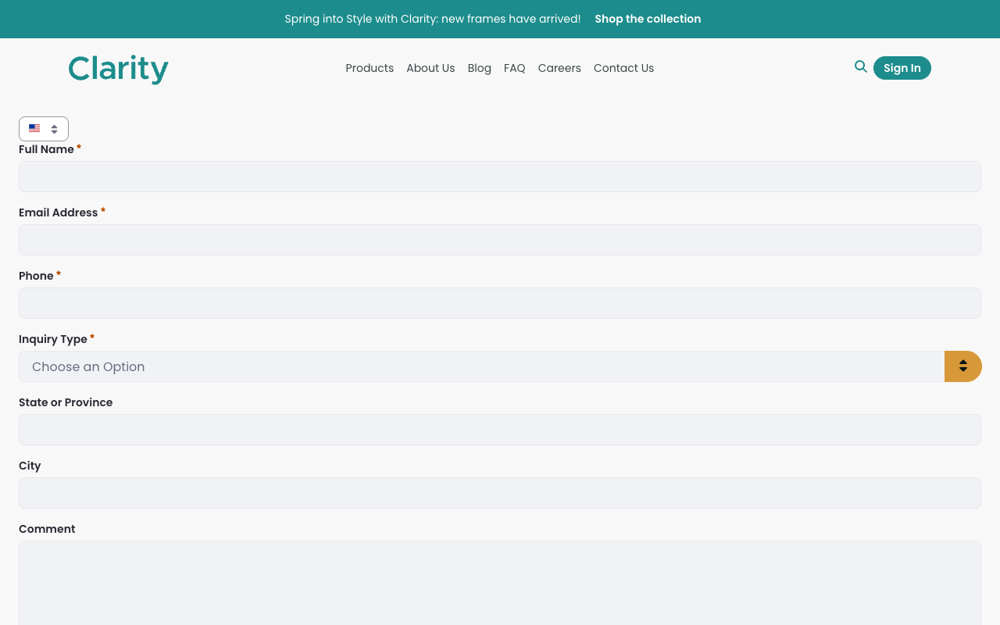
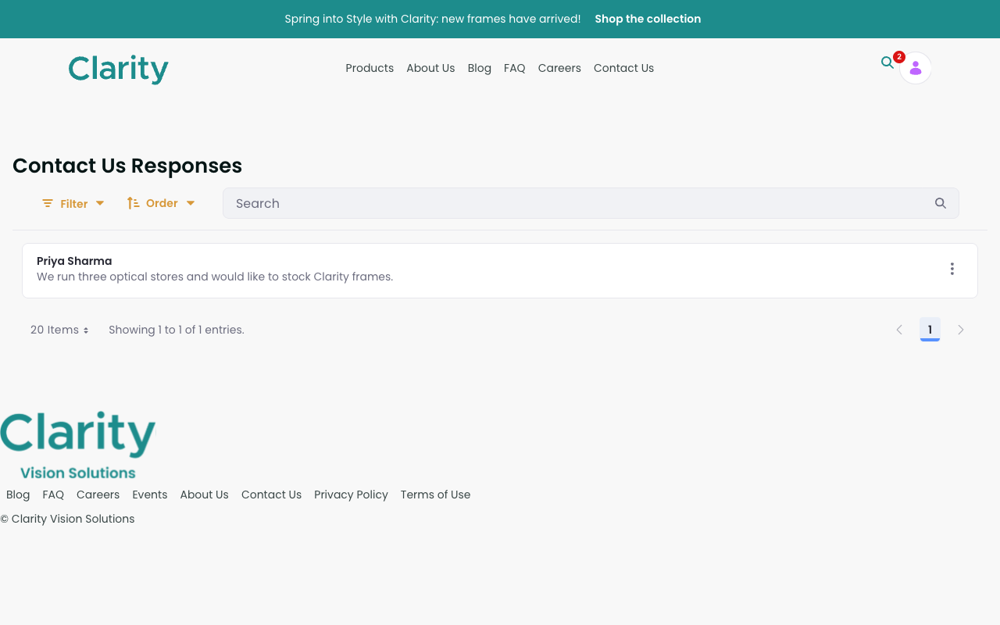

# Level 12 — Objects: the Contact Us form and its follow-up

⏱ **About 60 minutes**, with the talk · **Builds on:** Levels 1 and 3

**What you'll build:** a Contact Us form that stores each visitor's request, a workflow that routes each new request to a Distributor Representative, and a dashboard where they follow up.

**Key terms**
- **Object:** a data type you define; Liferay generates its storage, its REST APIs, a basic admin UI and permissions.
- **Picklist:** a reusable, translatable list of options that an object field can use.
- **Form Container:** turns a content page section into a form that creates an object entry.
- **Data Set:** shows entries as a filterable, sortable table or list.
- **Data Set fragment:** the fragment that places a Data Set on a page.

### 12.1 — The Inquiry Types picklist and the Contact Us object

🎯 **Goal:** an **Inquiry Types** picklist in English and Spanish, and a site-scoped **Contact Us** object with seven fields, published.

**Requirement:** R12 · **Skills:** `manage-objects`

💬 **Prompt:**
```
Using the manage-objects skill:

1. Create the picklist "Inquiry Types" (ERC INQUIRY_TYPES) with the items
   Sales, Support, Partnership and General (keys sales, support,
   partnership, general), translated into Spanish (es_ES): Ventas,
   Soporte, Asociación, General.
2. Create and publish the object "Contact Us" (name ContactUs, ERC
   CONTACT_US), site-scoped, shown under Content & Data, with entry history
   in the audit framework, not shown as a widget, and these fields: Full
   Name (fullName, text, required), Email Address (emailAddress, text,
   required), Phone (phone, text, required), Inquiry Type (inquiryType,
   picklist Inquiry Types, required, translatable), State or Province
   (stateOrProvince, text), City (city, text), Comment (comment, long
   text, translatable).
3. Grant the Web Developer role every permission on Contact Us. Grant
   Guest ADD_OBJECT_ENTRY only (visitors submit; they never read
   submissions).

Read the object back with its fields and REST path.
```

✅ **Verify** (look, don't change anything):
1. *Global Menu* → *Control Panel* → *Picklists* → **Inquiry Types**: four items.
2. Switch the language to Spanish: *Ventas, Soporte, Asociación, General*.
3. *Global Menu* → *Control Panel* → *Objects* → **Contact Us**: published, scope *Site*, seven fields.

### 12.2 — The Contact Us form

🎯 **Goal:** a styled form on the Contact Us page that creates Contact Us entries, for visitors who aren't signed in.

**Requirement:** R12 · **Skills:** `manage-form-containers`, `manage-pages`

💬 **Prompt:**
```
Using the manage-form-containers skill, add a Form Container for Contact Us
to a "Contact Form" container on the Contact Us page in
client-extensions/clarity-site: padding spacer 4, body background, 15px
radius; a localization selector (small, language label hidden); the fields
in the order Full Name, Email Address, Phone, Inquiry Type, State or
Province, City, Comment, each with bottom padding spacer 3; and a submit
button. Deploy, then submit one test entry as Guest through the form's own
endpoint and show me it was created.
```

📋 **After the prompt:**
1. Open **Contact Us** in a private window and submit an entry yourself.

✅ **Verify** (look, don't change anything):
1. In the private window, the Contact Us form shows its seven fields and a submit button.
2. As the admin, *Site Menu* → *Content & Data* → **Contact Us**: your entry and the agent's are listed.



### 12.3 — A follow-up workflow for new requests

🎯 **Goal:** each new Contact Us entry creates a **Follow Up** task for the Distributor Representative role, which is notified; approving it approves the entry.

**Requirement:** R12 · **Skills:** `manage-object-logic`

💬 **Prompt:**
```
Using the manage-object-logic skill, create and publish a workflow "Contact
Us Follow Up" (with an ERC): start → a task "Follow Up" (node name
followUp, description "Ask a Distributor Representative to verify a new
Contact Us submission.") assigned to the Distributor Representative role,
with a user notification to that role: "There is a new ${entryType} request
for you to follow up with." → transition "Approve" (approve_contact_us_entry)
→ end, where the end node sets the status to approved. The start → task
transition is "Review" (review_contact_us_entry). Link it to the Contact Us
object on the site clarity-public. Read the link back.
```

✅ **Verify** (look, don't change anything):
1. *Global Menu* → *Applications* → *Process Builder*: **Contact Us Follow Up** is published.
2. Open it: the *Follow Up* task is assigned to *Distributor Representative*. Close without saving.
3. *Site Menu* → *Configuration* → *Workflow*: **Contact Us** uses it.

### 12.4 — The Contact Us Responses dashboard

🎯 **Goal:** a **Contact Us Responses** data set of pending requests (list view, filters, sorting, view and delete actions) on a hidden **Contact Us Responses** page.

**Requirement:** R12 · **Skills:** `manage-data-sets`, `manage-pages`

💬 **Prompt:**
```
Using the manage-data-sets skill, create a data set "Contact Us Responses"
(ERC CONTACT_US_RESPONSES) on the Contact Us object's site-scoped REST
endpoint, showing only entries pending review. List view: title fullName,
description comment. Filters: a date range on dateCreated ("Create Date")
and a selection on inquiryType from the Inquiry Types picklist. Sorts:
Name (fullName, default), Create Date (dateCreated), City (city). Item
actions: View (opens the entry's admin page, built from its ERC, not a
hard-coded URL) and Delete (async DELETE with a confirmation, danger
style, success and error messages).

Access expectations: the Distributor Representative role can view and
delete Contact Us entries (company scope); Guest can still only add them.

Then add a hidden page "Contact Us Responses" (/contact-us-responses) to
client-extensions/clarity-site, viewable by the Distributor Representative
role and site members only, not Guest, holding the Data Set fragment with
this data set. Deploy.
```

📋 **After the prompt:**
1. In a private window, as Guest, submit two entries on **Contact Us**.
2. Sign in as **Daniel Raymond** in a private window. User menu (the avatar, top right) → *My Workflow Tasks* → *Assigned to My Roles*: assign one of the two tasks to yourself and **Approve** it.

✅ **Verify** (look, don't change anything):
1. Still as Daniel, open the notifications (the bell): a notification announces each new request.
2. Open `/web/clarity/contact-us-responses`: the entry you approved is gone; the other one is listed, pending.
3. Sort the list by Name and filter it by Inquiry Type: the list follows.



📖 **Why it matters:** approving the task as Daniel is how you'd accept the workflow in a real project. The data set shows only entries pending review, so an approved request leaves the dashboard.

## ⭐ Extras

Optional, for when you finish early. The next level doesn't depend on them.

### ⭐ 12.5 — Bonus: a two-step form

🎯 **Goal:** the Contact Us form in two steps with a Stepper: contact details, then the request. You write the prompt yourself.

✅ **Success looks like:**
1. *Allow Users to Save Entries as Draft* is enabled on Contact Us.
2. The form has two steps: contact details, then the request.
3. Step one has *Next*; step two has *Previous* and *Submit*.
4. A visitor completes both steps and one entry is created.
