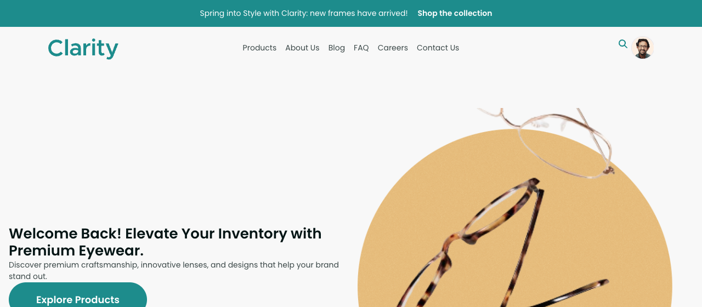

# Level 13 — Personalization: a Home page for distributors

📖 Distributors who sign in should be welcomed back and shouldn't be asked to become distributors. Liferay's classic way to do this, **DXP segments and experiences**, is deprecated on 2026.Q1 and later: segmentation moves to **Liferay Data Platform**, which needs a Data Platform workspace connected to your instance. Your instructor shows that in the slides.

📖 Without a Data Platform connection, you can still tailor a page by **who the visitor is**: a fragment can read the signed-in user's user groups and decide whether to render what's dropped inside it. That's what you'll build: a reusable **Clarity Audience Container** fragment, using only non-deprecated features.

### 13.1 — The Clarity Audience Container fragment

🎯 A fragment with a drop zone that renders its content only for members of a chosen user group, or only for everyone else.

🧩 `scaffold-fragment`

📎 R13.

💬 **Prompt:**
```
Using the scaffold-fragment skill, add a "Clarity Audience Container"
fragment to the Clarity Components set in client-extensions/clarity-site:
a drop zone whose content renders only when the configured audience
matches. Configuration: userGroup (text: a user group name, e.g.
"Distributors") and mode (select: "members" = show only to signed-in
members of that user group, "others" = show to everyone else, Guest
included). Decide in FreeMarker on the server, not with JavaScript, so
hidden content never reaches the browser. In the page editor, always show
the content, with a small label saying who it's for. Deploy, then check the
fragment compiled.
```

✅ **Verify:** Site Menu → *Design* → *Fragments* → **Clarity Components**: **Clarity Audience Container** is listed. Open it: the *Configuration* tab shows *userGroup* and *mode*. Close without publishing.

### 13.2 — A distributor variant of Home

🎯 Signed-in distributors see *Welcome Back! Elevate Your Inventory with Premium Eyewear.* and no distributor promotion; everyone else sees the usual Home.

🧩 `manage-pages`, `scaffold-fragment`

📎 R13.

💬 **Prompt:**
```
In client-extensions/clarity-site, on the Home page:
- wrap the Banner in a Clarity Audience Container (userGroup
  "Distributors", mode "others"), and add a copy of the Banner in a second
  Audience Container (userGroup "Distributors", mode "members") whose
  heading reads "Welcome Back! Elevate Your Inventory with Premium
  Eyewear.";
- wrap the Distributor Promo container in an Audience Container
  (userGroup "Distributors", mode "others").
Deploy, then fetch Home as Guest and as Terrence Wheatley (training
password "learn", a member of Distributors) in a real browser session, and
show me the banner heading and whether the Distributor Promo is present
for each.
```

✅ **Verify:**
- In a private window, sign in as **Terrence Wheatley**: Home says *Welcome Back!…* and has no *Become a Clarity Distributor* section. Sign out: the default Home is back, with the promotion.
- Open **Home** in edit mode: both banners show, each labeled with its audience. Leave without publishing.



📖 This works for signed-in users and user groups. For anonymous visitors (by behavior, location or campaign), you need Liferay Data Platform segments, which is the supported path for that kind of personalization.
