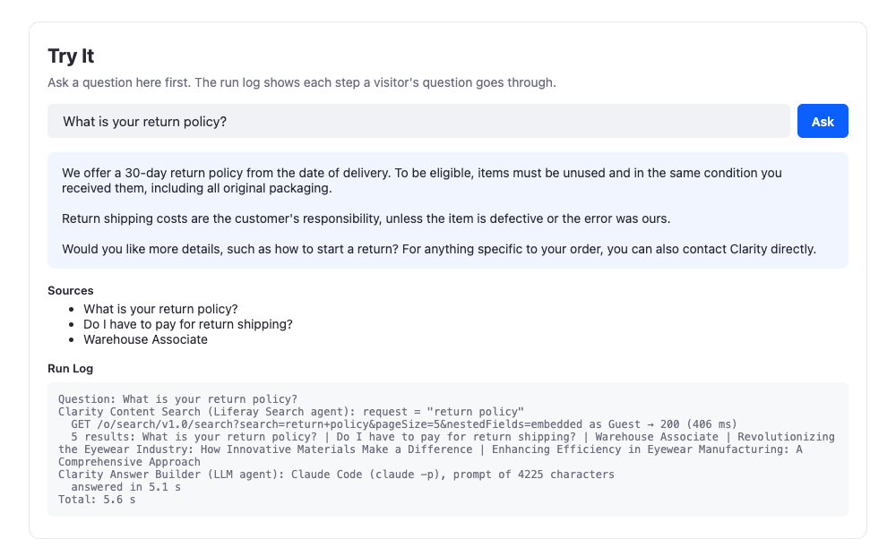
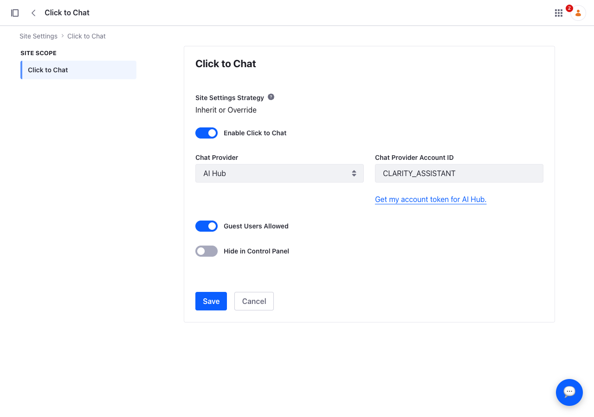
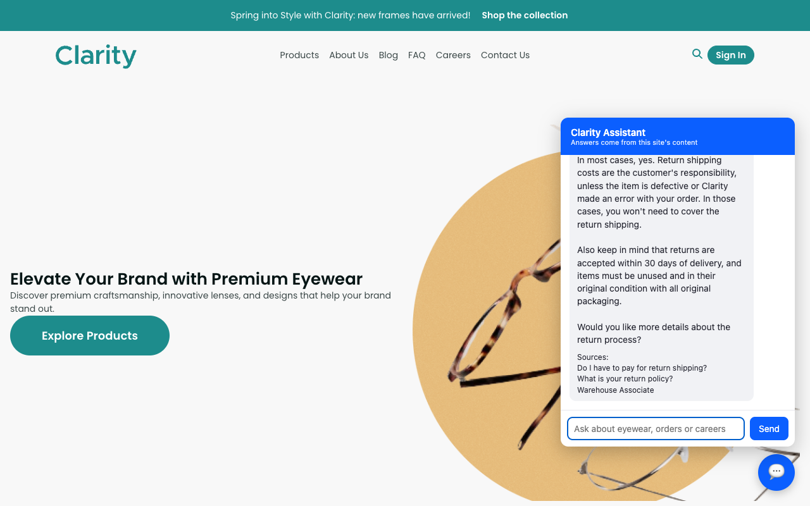

# Level 14 — Liferay AI Hub: an AI chatbot for your website (bonus)

⏱ **About 45 minutes**, on your own, after the course or when you finish early · **Builds on:** Levels 6 and 7 (content to answer from), and the Clarity site and its master pages

**What you'll build:** with **Liferay AI Hub**, a **Clarity Assistant** chatbot on every page of the public site. A visitor asks a question; the chatbot searches the site's content, and an AI writes a short answer from what it found, with its sources. You build it exactly as you would in AI Hub: a search agent, an answer agent, a chatbot that uses both, then Liferay's *Click to Chat* to put it on the site. As in the rest of the course, your agent does the setup from your prompts, and you check each step on AI Hub's screens and in Liferay.

🚀 **Why Liferay AI Hub:** it's Liferay's cloud service for AI agents and chatbots, built to work with your Liferay.
- **Build agents visually** in *Agent Builder*: each agent is a workflow of nodes (LLM, Liferay Search, HTTP requests, AI decisions, forks), with prompts and variables you set on screen.
- **Start from Liferay's own agents**: ready-made agents for writing, translation, categorization, tagging, SEO titles and descriptions, and image generation. Duplicate one and adapt it.
- **Grounded in your content**: Liferay Search agents answer from your Liferay, within its permissions, and data sources add more.
- **Governed**: guardrails, a risk classification for every agent, the model provider's compliance documentation, and an activity log.
- **Put to work anywhere**: chatbots on any site through Click to Chat or their chatbot code, and agents behind the AI Assistant in Liferay CMS. The models run in Liferay's cloud: nothing to host.

ℹ️ **In this course:** so that everyone can try it, even without an AI Hub account yet, this level uses a **course mock** of AI Hub that runs on your computer. It copies AI Hub's screens and setup, and its chatbot answers with **the AI agent you already use** in this course instead of AI Hub's models. The steps are the same in the real AI Hub.

**Key terms**
- **Liferay AI Hub:** Liferay's cloud service for AI agents and chatbots. You build agents in its *Agent Builder*, combine them in a *chatbot*, and put the chatbot on a site. This level's course mock copies its screens.
- **Agent:** one step a chatbot runs, with a small workflow: *Start → one node → End*. A **Liferay Search agent** searches your Liferay; an **LLM agent** asks a language model to write text.
- **RAG (retrieval-augmented generation):** first retrieve content that may answer the question, then have a language model answer from that content only. It keeps the answers grounded in your site instead of the model's memory.
- **Service Access Policy:** a Liferay rule that decides which API methods a caller may reach at all, before any permission is checked. Anonymous visitors get almost none by default.
- **Click to Chat:** Liferay's setting that adds a chat to every page of a site, from a chat provider such as AI Hub.

ℹ️ **Note:** the mock is in `bonus/ai-hub/` (no install: it only needs Node.js 20 or later, which the Playwright bonuses use too). It runs your agent's command line non-interactively, in an empty folder: with Claude Code every tool is switched off, so the chatbot can only write text; other agents run in their read-only modes. Each answer takes 5 to 30 seconds and uses your agent subscription, like any other prompt. See `bonus/ai-hub/README.md` for how it works.

### 14.1 — Start the AI Hub mock

🎯 **Goal:** the AI Hub mock running at `http://localhost:3010`, and its console open next to your agent.

**Requirement:** none (bonus) · **Skills:** none, you do this yourself

📋 **Steps** (there's no prompt in this exercise: like Liferay, you start and stop the mock yourself, never the agent):
1. Open a **second terminal** in VS Code (*Terminal* → *New Terminal*), and start the mock from the workspace root:
   ```bash
   node bonus/ai-hub/server.mjs
   ```
   It prints which AI agent will write the answers, for example `Answers from: Claude Code (claude -p)`. It looks for `claude`, `codex`, `copilot` and `gemini`, in that order. To choose one, start it with `AI_CLI=codex node bonus/ai-hub/server.mjs` (on Windows PowerShell: `$env:AI_CLI="codex"; node bonus/ai-hub/server.mjs`).
2. Open `http://localhost:3010` in your browser: the **AI Hub** console, with *Agent Builder*, *Chatbots* and *Configurations*. Its screens copy AI Hub's, including the full-page editors with **Cancel** and **Save** at the top. What the mock doesn't have (*Account Management*, an agent's *Data Sources* and *Guardrails*, a chatbot's *Avatar* and *Suggested Questions*, other languages) is greyed out, and what only the mock has is marked **Course mock**. Keep it open: in the next exercises your agent sets AI Hub up through the console's API, and you check each step on these screens.

### 14.2 — Connect the mock, and let anonymous visitors search

🎯 **Goal:** the mock pointing at your Liferay, and Guest allowed to call Liferay's headless search API, so the chatbot can search what any visitor may see, and nothing more.

**Requirement:** none (bonus) · **Skills:** none named: the agent reads `rules/guest-access.md` and the mock's README

💬 **Prompt:**
```
The AI Hub mock in bonus/ai-hub runs at http://localhost:3010; its API
is in bonus/ai-hub/README.md. Point its configuration at my Liferay and
run its connection test. If Liferay refuses the search as Guest, find
out why with rules/guest-access.md, and give me the exact UI steps to
allow only the headless search's getSearchPage method for Guest. When I
say it's done, run the connection test again, then fetch
/o/search/v1.0/search?search=return%20policy as Guest and show me the
titles.
```

The first test fails with a **403**: Liferay's Service Access Policy keeps the search API closed to Guest. Service Access Policies have no headless API, so the agent gives you the steps, and you do them. They should match these:
1. *Global Menu* → *Control Panel* → *Security* → **Service Access Policy** → **New**.
2. **Name:** `CLARITY_GUEST_SEARCH`. **Enabled:** on. **Default:** on (a policy applies to anonymous requests only when it's a default one). **Title:** `Clarity Guest Search`.
3. **Service Class:** `com.liferay.portal.search.rest.internal.resource.v1_0.SearchResultResourceImpl`, **Method Name:** `getSearchPage`. **Save**.

Then tell the agent it's done.

✅ **Verify** (look, don't change anything):
1. In the mock's **Configurations**, *Environment URL* is your Liferay (`http://localhost:8080`). In the **Course Mock** card below it, click **Test Connection**: *Liferay answered a search as Guest: … → 200*.
2. In a private window, open `http://localhost:8080/o/search/v1.0/search?search=return%20policy`: JSON with Clarity's FAQ entries about returns.

📖 **Why it matters:** two gates protect your content from an API call. The Service Access Policy decides whether the API method can be reached at all; then permissions decide which results come back. This policy opens only the first gate, for one read method: the search still runs as Guest, so it returns only what Guest may view (your public FAQs, products and articles), never a persona's or the admin's content. A public chatbot is only as public as its content's permissions. The real AI Hub is a cloud service: it needs a public HTTPS URL for your Liferay, and signs in with an OAuth client. The mock runs next to your Liferay, so `localhost` works.

### 14.3 — Build the two agents

🎯 **Goal:** a **Clarity Content Search** agent that searches your Liferay, and a **Clarity Answer Builder** agent that writes the answer.

**Requirement:** none (bonus) · **Skills:** none named: the agent reads the mock's README

💬 **Prompt:**
```
Using the AI Hub mock's API (bonus/ai-hub/README.md), create two enabled
agents, keeping AI Hub's default user messages:
1. A Liferay Search agent "Clarity Content Search", ERC
   CLARITY_CONTENT_SEARCH, description "Retrieval worker for Clarity Vision
   Solutions: products, FAQs, articles and job openings.", prompt "Use only the retrieved
   content as evidence. Do not invent or infer missing facts.", searching
   my Liferay with no Search Blueprint.
2. An LLM agent "Clarity Answer Builder", ERC CLARITY_ANSWER_BUILDER,
   description "Always runs last: writes the answer from the gathered
   information.", prompt "You are Clarity Vision Solutions' website
   assistant. Build a clear, short answer to the original request from the
   gathered information alone. Never invent facts. If the information
   doesn't cover the question, say so and suggest contacting Clarity.
   Offer more details at the end."
Then show me both agents as the API stored them.
```

✅ **Verify** in the mock's console (look, don't change anything):
1. **Agent Builder** lists both agents, **Running**, one labelled *Liferay Search agent* and one *LLM agent*.
2. Open **Clarity Content Search**, then **Edit Workflow**: the canvas shows **Start → Liferay Search → End**, and the panel on the right lists AI Hub's node types. Click the **Liferay Search** node: its panel has the prompt, the **User Message** `{{request}}`, and the **Retrieval-Augmented Generation** configuration with `"key": "liferay"` (your Liferay, no blueprint). Click **Start** and **End**: they show the variables going in and out.
3. Open **Clarity Answer Builder**'s workflow: **Start → LLM → End**, and its **User Message** passes `{{originalRequest}}` and `{{gatheredInformation}}`, the search results.


📖 **Why it matters:** splitting retrieval from writing is the RAG pattern. The search agent decides *what the chatbot knows*; the LLM agent decides *how it speaks*. The prompt that says "from the gathered information alone" is what stops the model from answering from its own memory.

### 14.4 — Create the chatbot and try it

🎯 **Goal:** a **Clarity Assistant** chatbot that uses both agents, tried in the console.

**Requirement:** none (bonus) · **Skills:** none named: the agent reads the mock's README

💬 **Prompt:**
```
Using the AI Hub mock's API, create an enabled chatbot "Clarity
Assistant", ERC CLARITY_ASSISTANT, with both Clarity agents assigned, the
placeholder message "Ask about eyewear, orders or careers" and the intro
message "Hi! I'm the Clarity Assistant. Ask me about our eyewear, orders
and returns, or careers at Clarity." Then ask it "What is your return
policy?" through its chat endpoint, as a site would, and show me the
answer, its sources and its run log.
```

✅ **Verify** in the mock's console (look, don't change anything):
1. **Chatbots** → **Clarity Assistant**: **Enable Chatbot** is on, and both agents are chips under **Assigned Agents**.
2. In **Try It**, ask `What is your return policy?`, and read the **Run Log**: the search request, its results, then your agent's answer and how long each step took. The answer says returns are accepted within **30 days** of delivery, for unused items, and **Sources** lists *What is your return policy?*.
3. Ask `How many years of warranty do your frames have?`: Clarity's content doesn't say, so the answer says it found no warranty information, and doesn't make a number up.



⚠️ **If it doesn't match:**
- *No enabled Liferay Search agent assigned:* the agent isn't enabled, or its ERC isn't in the chatbot's agents. Check both in the console.
- *Liferay refused the search as Guest (403):* redo 14.2; check that the policy is both **Enabled** and **Default**.
- *The answer lists results instead of a written answer:* the mock found no agent command line, or no enabled LLM agent is assigned. The terminal running the mock says which.
- *exited with … or didn't answer within 120 seconds:* run your agent once in a terminal (for example `claude -p "hello"`) to check it's signed in.

### 14.5 — Put the chatbot on every page, with Click to Chat

🎯 **Goal:** the chat bubble on every page of the public site, for anyone, Guest included, added the way you add an AI Hub chatbot: with Liferay's **Click to Chat** and its **AI Hub** provider, set in code.

**Requirement:** none (bonus) · **Skills:** `manage-sites`, `browser-verify`

💬 **Prompt:**
```
Using the manage-sites skill, put the Clarity Assistant on every page of
the Clarity site with Liferay's Click to Chat and its AI Hub provider,
pointed at the AI Hub mock, all in code. bonus/ai-hub/README.md ("How
Liferay loads the chat") has the settings:
- AI Hub (the mock's Client ID, Client Secret and Service URL
  http://localhost:3010) and Click to Chat for the instance (enabled, site
  settings strategy inherit-or-override), as OSGi configuration files in
  configs/local/osgi/configs and bundles/osgi/configs;
- Click to Chat for clarity-public in the site initializer's
  site-settings.json: the AI Hub provider, account ID CLARITY_ASSISTANT,
  guest users allowed.
Deploy with scripts/deploy_site.sh, then use the browser-verify skill to
open Home as Guest, click the chat bubble and show me its first message.
```

✅ **Verify** (look, don't change anything):
1. As the admin, on the Clarity site: *Site Menu* → *Configuration* → *Site Settings* → **Click to Chat**: enabled, **Chat Provider** *AI Hub*, **Chat Provider Account ID** `CLARITY_ASSISTANT`, **Guest Users Allowed** on, all from `site-settings.json`.
2. In a private window (as Guest), open Clarity's Home page: a round chat bubble sits bottom right. Click it: *Clarity Assistant* and its intro message.
3. Ask `Do I have to pay for return shipping?`: after a few seconds, an answer (yes, unless the item is defective or Clarity made an error) and its sources.
4. Open another page, such as *FAQ*: the bubble is there too.





ℹ️ **Note:** *Instance Settings* → *Platform* → **AI Hub** only appears once the release feature flag **AI Hub (LPD-62272)** is on (*Instance Settings* → *Platform* → *Feature Flags* → *Release*). The configuration file works without it; turn the flag on if you want to see the values on that screen.

🧪 **Acceptance criteria** (what the level's Playwright check tests, in ⭐ Extras):

- **AC 14.2-1** · *API, as Guest:* `GET /o/search/v1.0/search?search=return policy` answers 200, and its items include *What is your return policy?*.
- **AC 14.4-1** · *API, as the console (`http://localhost:3010/api/state`):* the chatbot `CLARITY_ASSISTANT` is enabled, and its assigned agents are an enabled Liferay Search agent and an enabled LLM agent.
- **AC 14.4-2** · *API, as a site (`POST http://localhost:3010/api/chatbots/CLARITY_ASSISTANT/chat`):* *What is your return policy?* gets an answer that mentions 30 days, with *What is your return policy?* among its sources.
- **AC 14.5-1** · *Browser, as Guest:* Home and the FAQ page have Click to Chat's AI Hub script (`script#aihub-chatbot-widget-script`) from `http://localhost:3010`, with `chatbot-external-reference-code="CLARITY_ASSISTANT"`, and clicking the bubble shows the intro message.

⚠️ **If it doesn't match:**
- *No bubble, and the agent's browser check found the chat's script:* the mock isn't running. Start it again (14.1): the site only links to it.
- *No bubble, and no Click to Chat values in Site Settings:* `site-settings.json` wasn't deployed; ask the agent to check it's in `client-extensions/clarity-site/site-initializer/` and to deploy again.
- *Site Settings has the values, but no bubble even signed in:* the instance files are missing from `bundles/osgi/configs`, or Click to Chat for the instance isn't *Inherit or Override* (check *Instance Settings* → *Content and Data* → *Click to Chat*).
- *The bubble says the chat isn't available:* the chatbot is disabled, or its ERC differs from the *Chat Provider Account ID*.

📖 **Why it matters:** these are the same settings you'd make with the real AI Hub; only the *Service URL* and the credentials would come from your AI Hub account instead of the mock. Kept in code, they come back with every deploy and every new environment, like the rest of the site. Click to Chat puts one chatbot on every page of a site, without touching a page or a master, and a site can override the instance's choice. The bubble only links to AI Hub: stop the mock, and the site keeps working, without a chat.

🚀 **Next: the real Liferay AI Hub.** Everything in this level is AI Hub's own setup: the same agents, the same chatbot, the same Click to Chat settings, with AI Hub's *Service URL* and credentials instead of the mock's. On the real AI Hub you also get Liferay's ready-made agents, guardrails, data sources, managed models and the AI Assistant in Liferay CMS. To use it with your Liferay, talk to your Liferay account team.

## 🧠 Knowledge check

⏱ **About 3 minutes, on your own.** Choose one answer for each question. The answers are at the end of `bonus/ai-hub/README.md`.

**Question 1.** Signed in as the admin, the chatbot's search finds nothing that Guest can't see. Why?

- **A.** The search API never returns admin content.
- **B.** The mock searches as Guest, so permissions limit results to what Guest may view.
- **C.** The Service Access Policy hides admin content.
- **D.** The LLM agent filters out private results.

**Question 2.** Which setting keeps the chatbot from answering with facts that aren't on Clarity's site?

- **A.** The Service Access Policy.
- **B.** The search agent's Retrieval-Augmented Generation configuration, `"key": "liferay"`.
- **C.** The LLM agent's prompt: answer from the gathered information alone.
- **D.** The chatbot's intro message.

**Question 3.** You remove the Service Access Policy. What does a visitor see?

- **A.** The chatbot answers as before, with fewer sources.
- **B.** The bubble disappears from the site.
- **C.** Liferay asks the visitor to sign in.
- **D.** The chatbot can't search, so it can't answer.

## ⭐ Extras

Optional, for when you finish early.

### ⭐ 14.6 — Bonus: search through a blueprint

🎯 **Goal:** a second search agent that searches through the **Boost Associate Job Listings** blueprint from 11.2, so career questions get job listings only.

💬 **Prompt:**
```
Using the AI Hub mock's API, add an enabled Liferay Search agent "Clarity
Jobs Search" (ERC CLARITY_JOBS_SEARCH, description "Job openings at
Clarity.") that searches through the BOOST_ASSOCIATE_JOB_LISTINGS
blueprint, and assign it to CLARITY_ASSISTANT too. Then ask the chatbot
"Are you hiring warehouse staff?" and show me the run log.
```

✅ **Success looks like:** the agent's workflow panel in the console shows `"blueprintExternalReferenceCode": "BOOST_ASSOCIATE_JOB_LISTINGS"`, and **Try It**'s run log for the same question shows two searches, the second with `blueprintExternalReferenceCode`.

ℹ️ **Note:** blueprints are part of Liferay Enterprise Search, which the DXP Free Tier key doesn't include (*Setup*, S.2). If *Applications* has no *Blueprints*, skip this bonus; if you took 11.2's free-key path, you have no blueprint to search through anyway.

### ⭐ 14.7 — Bonus: check Level 14 with Playwright

🎯 **Goal:** `tests/e2e/level-14.spec.ts`, with one test per acceptance criterion (🧪) of Level 14, added to the Playwright suite from 1.3. Write the prompt yourself: start from 1.3's and point it at this level's criteria. AC 14.4-2 waits for your agent's answer, so give it a 2-minute timeout.

✅ **Success looks like:**
1. With the mock running, `npx playwright test level-14` runs one test per acceptance criterion, each named by its id, and all pass.
2. Stop the mock: AC 14.4-1, AC 14.4-2 and AC 14.5-1 fail, and AC 14.2-1 still passes. Start it again: all pass.

### ⭐ 14.8 — Bonus: the embed snippet instead of Click to Chat

🎯 **Goal:** the same bubble from a fragment, for a site that doesn't use Click to Chat. It uses the **Chatbot Code** that AI Hub shows at the bottom of a chatbot's page, as the mock does.

💬 **Prompt:**
```
Using the scaffold-fragment and theme-and-design skills, add a "Clarity
Chat" fragment to the Clarity Components set in
client-extensions/clarity-site. Configuration: chatbotERC (text, default
"CLARITY_ASSISTANT") and aiHubURL (text, default "http://localhost:3010").
On the live page, its HTML is only the Chatbot Code that the AI Hub
mock shows at the bottom of the Clarity Assistant chatbot's page, with
the chatbot's ERC and the AI Hub URL taken from those two values.
In the page editor (layoutMode "edit"), render a small dashed label
"Clarity Chat: <chatbotERC>" instead of the script. Place it at the end of
both master pages, after the footer, with those two values. Deploy with
scripts/deploy_site.sh, then fetch Home as Guest and show me the
chatbot code in the HTML.
```

✅ **Success looks like:** turn Click to Chat off in Clarity's *Site Settings*: the bubble still shows on every page, now from the fragment. One page shows one bubble, even with both on.
